|Website| |Platforms| |Python| |Qt| |Test counts| |Coverage| |Issues| |Conda| |PyPI| |Docker| |PyPI Downloads| |Docs| |Tutorials| |Preprint| |DOI| |Cite| |License| |PyPI rank|

.. |Website| image:: https://img.shields.io/badge/Website-spaCR-0A7BBB
   :target: https://einarolafsson.github.io/projects/spacr/
   :alt: spaCR-Website

.. |Docs| image:: https://img.shields.io/github/actions/workflow/status/EinarOlafsson/spacr/pages%2Fpages-build-deployment?label=API&logo=readthedocs&logoColor=white
   :target: https://einarolafsson.github.io/spacr/
   :alt: API-Dokumentation

.. |Tutorials| image:: https://img.shields.io/badge/Tutorials-4A9EFF
   :target: https://einarolafsson.github.io/spacr/tutorials/
   :alt: Interaktive Tutorials

.. |PyPI| image:: https://img.shields.io/pypi/v/spacr?label=PyPI&logo=pypi&logoColor=white
   :target: https://pypi.org/project/spacr/
   :alt: PyPI-Version

.. |Python| image:: https://img.shields.io/badge/Python-3.9%E2%80%933.14-3776AB?logo=python&logoColor=white
   :target: https://pypi.org/project/spacr/
   :alt: Python 3.9 bis 3.14

.. |Coverage| image:: https://img.shields.io/codecov/c/github/EinarOlafsson/spacr/nightly?logo=codecov&logoColor=white
   :target: https://app.codecov.io/github/EinarOlafsson/spacr
   :alt: Codecov-Testabdeckung

.. |Test counts| image:: https://img.shields.io/endpoint?url=https%3A%2F%2Fraw.githubusercontent.com%2FEinarOlafsson%2Fspacr%2Fnightly%2Fdocs%2Fsource%2F_static%2Ftest-counts.json&cacheSeconds=300&logo=pytest&logoColor=white
   :target: https://github.com/EinarOlafsson/spacr/actions/workflows/tests.yml
   :alt: Testsuite

.. |Qt| image:: https://img.shields.io/badge/GUI-Qt-41CD52?logo=qt&logoColor=white
   :target: https://einarolafsson.github.io/spacr/api/spacr/qt/index.html#module-spacr.qt
   :alt: Qt-Oberfläche

.. |Issues| image:: https://img.shields.io/github/issues/EinarOlafsson/spacr?logo=github
   :target: https://github.com/EinarOlafsson/spacr/issues
   :alt: GitHub-Issues

.. |License| image:: https://img.shields.io/badge/License-BSD--3-blue?logo=opensourceinitiative&logoColor=white
   :target: https://github.com/EinarOlafsson/spacr/blob/main/LICENSE
   :alt: BSD-3-Clause-Lizenz

.. |Preprint| image:: https://img.shields.io/badge/bioRxiv-BF2636
   :target: https://www.biorxiv.org/content/10.64898/2026.07.08.737057v1
   :alt: bioRxiv-Preprint

.. |DOI| image:: https://img.shields.io/badge/DOI-blue?logo=zenodo&logoColor=white
   :target: https://doi.org/10.5281/zenodo.21343316
   :alt: Zenodo-DOI

.. |Conda| image:: https://img.shields.io/conda/vn/conda-forge/spacr?label=Conda&logo=anaconda&logoColor=white
   :target: https://anaconda.org/conda-forge/spacr
   :alt: conda-forge-Version

.. |Release date| image:: https://anaconda.org/conda-forge/spacr/badges/latest_release_date.svg
   :target: https://anaconda.org/conda-forge/spacr
   :alt: conda-forge-Datum der letzten Veröffentlichung

.. |Docker| image:: https://img.shields.io/badge/Docker-GHCR-2496ED?logo=docker&logoColor=white
   :target: https://github.com/EinarOlafsson/spacr/pkgs/container/spacr
   :alt: Docker-Images auf GHCR

.. |PyPI Downloads| image:: https://img.shields.io/pepy/dt/spacr?label=downloads&logo=pypi&logoColor=white
   :target: https://pepy.tech/projects/spacr
   :alt: PyPI-Downloads

.. |Platforms| image:: https://img.shields.io/badge/Linux%20OSX%20Win-lightgrey?logo=linux&logoColor=white
   :target: https://github.com/EinarOlafsson/spacr/blob/nightly/docs/source/installers.rst
   :alt: Linux, macOS und Windows

.. |Cite| image:: https://img.shields.io/badge/Cite-8A2BE2
   :target: https://github.com/EinarOlafsson/spacr/blob/main/CITATION.cff
   :alt: spaCR zitieren

.. |PyPI rank| image:: https://img.shields.io/badge/dynamic/json?url=https%3A%2F%2Fsql-clickhouse.clickhouse.com%2F%3Fuser%3Ddemo%26param_package_name%3Dspacr%26param_days%3D30%26query%3DWITH%2B%2528%2BSELECT%2Bsum%2528count%2529%2BFROM%2Bpypi.pypi_downloads_per_day%2BWHERE%2Bproject%2B%253D%2B%257Bpackage_name%253AString%257D%2BAND%2Bdate%2B%253E%253D%2BtoDate%2528now%2528%2527UTC%2527%2529%2529%2B-%2B%257Bdays%253AUInt16%257D%2BAND%2Bdate%2B%253C%2BtoDate%2528now%2528%2527UTC%2527%2529%2529%2B%2529%2BAS%2Bdownloads%2BSELECT%2Bdownloads%2BAS%2Bpackage_downloads%252C%2BcountIf%2528n%2B%253E%253D%2Bdownloads%2529%2BAS%2Brank%252C%2Bcount%2528%2529%2BAS%2Btotal_packages%252C%2B100.0%2B%252A%2Brank%2B%252F%2BnullIf%2528total_packages%252C%2B0%2529%2BAS%2Bpercentile%252C%2Bif%2528%2Btotal_packages%2B%253D%2B0%2BOR%2Bdownloads%2B%253D%2B0%252C%2B%2527no%2Bdata%2527%252C%2Bconcat%2528%2B%2527top%2B%2527%252C%2BtoString%2528ceil%25281000.0%2B%252A%2Brank%2B%252F%2BnullIf%2528total_packages%252C%2B0%2529%2529%2B%252F%2B10%2529%252C%2B%2527%2525%2527%2B%2529%2B%2529%2BAS%2Bmessage%2BFROM%2B%2528%2BSELECT%2Bproject%252C%2Bsum%2528count%2529%2BAS%2Bn%2BFROM%2Bpypi.pypi_downloads_per_day%2BWHERE%2Bdate%2B%253E%253D%2BtoDate%2528now%2528%2527UTC%2527%2529%2529%2B-%2B%257Bdays%253AUInt16%257D%2BAND%2Bdate%2B%253C%2BtoDate%2528now%2528%2527UTC%2527%2529%2529%2BGROUP%2BBY%2Bproject%2B%2529%2BFORMAT%2BJSON&query=%24.data%5B0%5D.message&label=Rank&color=brightgreen&logo=pypi&logoColor=white&cacheSeconds=86400
   :target: https://clickpy.clickhouse.com/dashboard/spacr
   :alt: spaCR-Rang bei PyPI-Downloads der letzten 30 vollen Tage

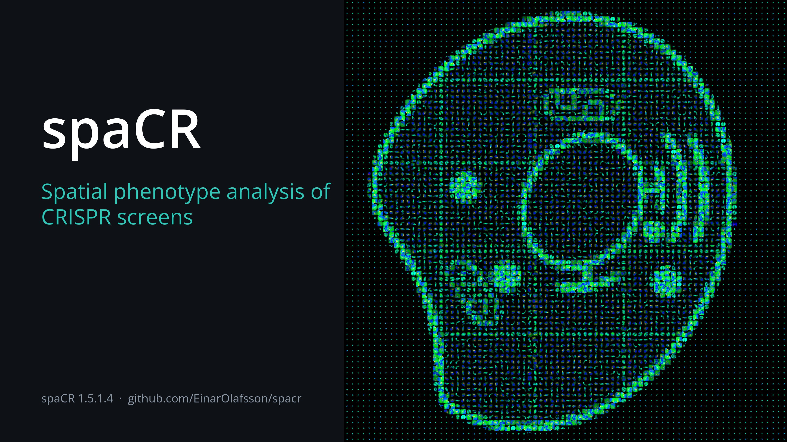

| |intro-1|\ |intro-2|

.. spacr-language-picker-begin

.. spacr-language-picker-end

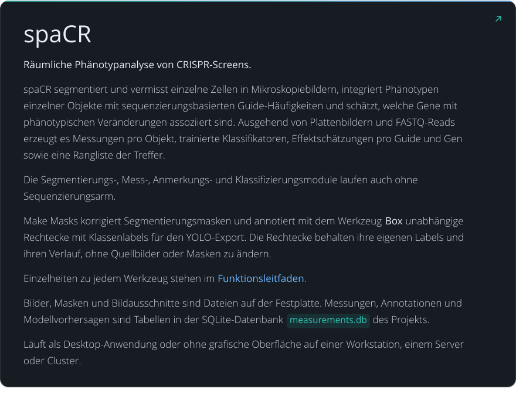eränderungen assoziiert sind. Ausgehend von Plattenbildern und FASTQ-Reads erzeugt es Messungen pro Objekt, trainierte Klassifikatoren, Effektschätzungen pro Guide und Gen sowie eine Rangliste der Treffer. Die Segmentierungs-, Mess-, Anmerkungs- und Klassifizierungsmodule laufen auch ohne Sequenzierungsarm. Make Masks korrigiert Segmentierungsmasken und annotiert mit dem Werkzeug Box unabhängige Rechtecke mit Klassenlabels für den YOLO-Export. Die Rechtecke behalten ihre eigenen Labels und ihren Verlauf, ohne Quellbilder oder Masken zu ändern. Einzelheiten zu jedem Werkzeug stehen im Funktionsleitfaden. Bilder, Masken und Bildausschnitte sind Dateien auf der Festplatte. Messungen, Annotationen und Modellvorhersagen sind Tabellen in der SQLite-Datenbank measurements.db des Projekts. Läuft als Desktop-Anwendung oder ohne grafische Oberfläche auf einer Workstation, einem Server oder Cluster.
   :width: 100%
   :target: ../../source/features.rst

.. code-block:: bash

   conda create -n spacr python=3.12 -y
   conda activate spacr
   python -m pip install spacr
   spacr

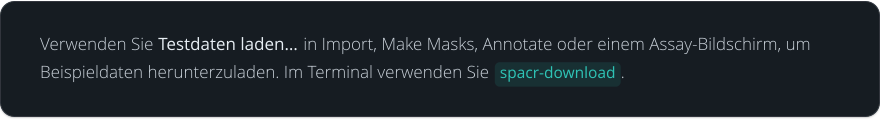

.. spacr-hardware-begin

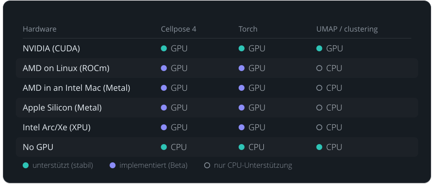

.. spacr-hardware-end

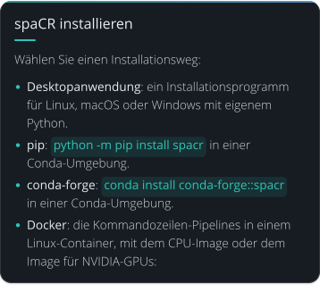

.. code-block:: bash

   docker run --rm ghcr.io/einarolafsson/spacr:1.5.1.4 spacr-run --list
   docker run --rm --gpus all ghcr.io/einarolafsson/spacr:1.5.1.4-cuda12.4 spacr-run --list

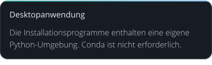

.. spacr-installer-links-begin

|InstallerLinux| |InstallerMacOS| |InstallerWindows|

.. spacr-installer-links-end

.. code-block:: bash

   chmod +x SpaCR-*-Linux-x86_64-Online.run
   ./SpaCR-*-Linux-x86_64-Online.run

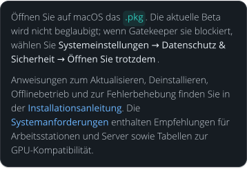ehlerbehebung finden Sie in der Installationsanleitung. Die Systemanforderungen enthalten Empfehlungen für Arbeitsstationen und Server sowie Tabellen zur GPU-Kompatibilität.
   :width: 100%

| |desktop-application-3-link-1|\ |desktop-application-3-link-2|

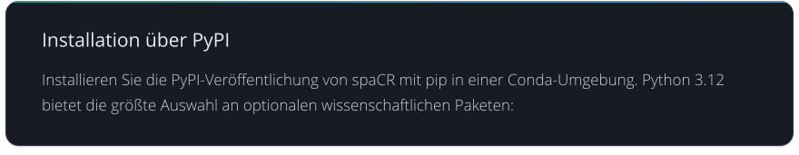

.. code-block:: bash

   conda create -n spacr python=3.12 -y
   conda activate spacr
   python -m pip install --upgrade pip
   python -m pip install spacr
   spacr

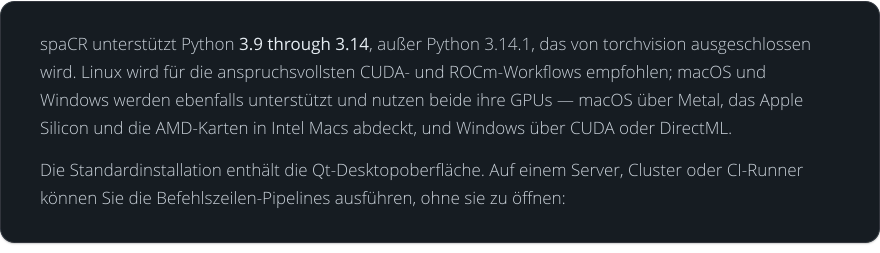acOS über Metal, das Apple Silicon und die AMD-Karten in Intel Macs abdeckt, und Windows über CUDA oder DirectML. Die Standardinstallation enthält die Qt-Desktopoberfläche. Auf einem Server, Cluster oder CI-Runner können Sie die Befehlszeilen-Pipelines ausführen, ohne sie zu öffnen:
   :width: 100%

.. code-block:: bash

   python -m pip install spacr
   spacr-run --list

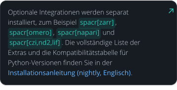

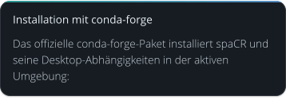

.. code-block:: bash

   conda create -n spacr python=3.12 -y
   conda activate spacr
   conda install conda-forge::spacr
   spacr

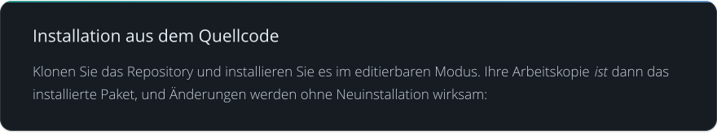

.. code-block:: bash

   git clone https://github.com/EinarOlafsson/spacr.git
   cd spacr
   conda create -n spacr python=3.12 -y
   conda activate spacr
   pip install -e .
   spacr

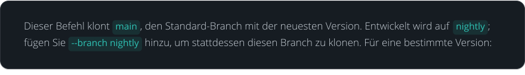

.. code-block:: bash

   git clone --branch v1.5.0.5 https://github.com/EinarOlafsson/spacr.git

.. code-block:: bash

   git pull
   pip install -e .

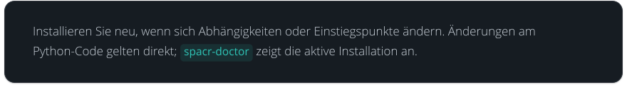

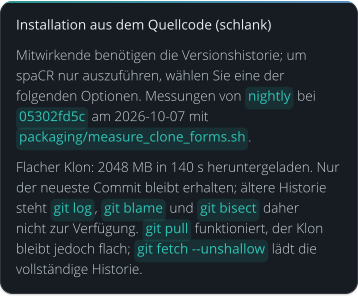

.. code-block:: bash

   # One commit instead of every version: 2048 MB downloaded, 140 s.
   # No history, so no git log, no git blame and no git bisect.
   # git pull still works, but stays shallow until git fetch --unshallow.
   git clone --depth 1 --branch nightly https://github.com/EinarOlafsson/spacr.git
   cd spacr && pip install -e .

   # Runtime files: 104 MB on disk, 6 s (Git: 38 MB; files: 66 MB).
   # No history, docs, tests, tools, features or example data.
   # --with-docs, --with-tests and --with-translations put those back;
   # --dir, --branch, --no-install and --help do the obvious things.
   # packaging/source_install_excludes.txt lists every skipped path.
   curl -fsSL https://raw.githubusercontent.com/EinarOlafsson/spacr/nightly/packaging/install_from_source.sh -o install_spacr.sh
   sh install_spacr.sh --branch nightly

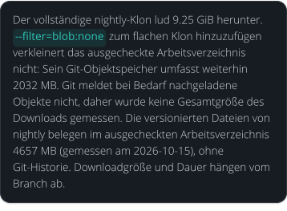am 2026-10-08), ohne Git-Historie. Downloadgröße und Dauer hängen vom Branch ab.
   :width: 100%

.. code-block:: bash

   spacr                                      # launch the Qt application
   spacr-doctor                               # diagnose the installation
   spacr-run --list                           # list headless modules
   spacr-run --describe MODULE                # inspect a module contract
   spacr-run MODULE --settings settings.csv   # execute a module
   spacr-run validate --module MODULE \
       --settings settings.csv                # validate before running
   spacr-repro RUN_DIR                        # replay a recorded run
   spacr-download --list                      # what example data exists
   spacr-download measure annotate            # fetch example sets by name
   spacr-make-masks --folder DIR              # curate masks as a resumable queue
   spacr-make-masks --folder DIR --order easy --limit 50

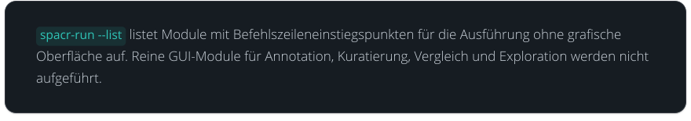

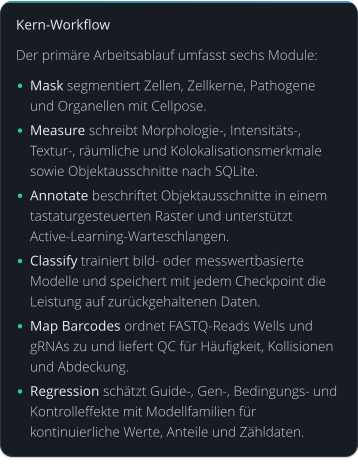taturgesteuerten Raster und unterstützt Active-Learning-Warteschlangen. Classify trainiert bild- oder messwertbasierte Modelle und speichert mit jedem Checkpoint die Leistung auf zurückgehaltenen Daten. Map Barcodes ordnet FASTQ-Reads Wells und gRNAs zu und liefert QC für Häufigkeit, Kollisionen und Abdeckung. Regression schätzt Guide-, Gen-, Bedingungs- und Kontrolleffekte mit Modellfamilien für kontinuierliche Werte, Anteile und Zähldaten.
   :width: 100%

.. spacr-workflow-begin

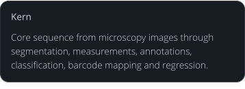

| |Module_mask|\ |Module_measure|\ |Module_annotate|\ |Module_classify_merged|\ |Module_map_barcodes|\ |Module_regression|

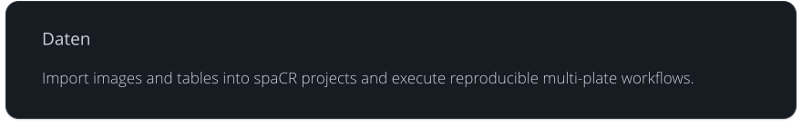

| |Module_foreign|\ |Module_embeddings|\ |Module_run_compare|\ |Module_experiment_design|\ |Module_power|\ |Module_dose_response|
| |Module_qc_dashboard|

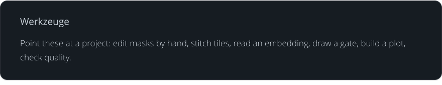

| |Module_make_masks|\ |Module_align|\ |Module_umap|\ |Module_gate_editor|\ |Module_graph_builder|

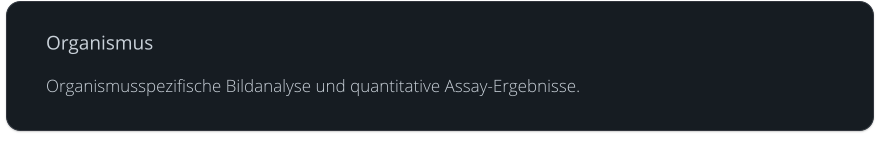

| |Module_toxoplasma|

.. |Module_mask| raw:: html

   

.. |Module_measure| raw:: html

   

.. |Module_annotate| raw:: html

   

.. |Module_classify_merged| raw:: html

   

.. |Module_map_barcodes| raw:: html

   

.. |Module_regression| raw:: html

   

.. |Module_foreign| raw:: html

   

.. |Module_embeddings| raw:: html

   

.. |Module_run_compare| raw:: html

   

.. |Module_experiment_design| raw:: html

   

.. |Module_power| raw:: html

   

.. |Module_dose_response| raw:: html

   

.. |Module_qc_dashboard| raw:: html

   

.. |Module_make_masks| raw:: html

   

.. |Module_align| raw:: html

   

.. |Module_umap| raw:: html

   

.. |Module_gate_editor| raw:: html

   

.. |Module_graph_builder| raw:: html

   

.. |Module_toxoplasma| raw:: html

   

.. spacr-workflow-end

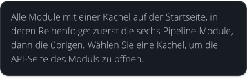

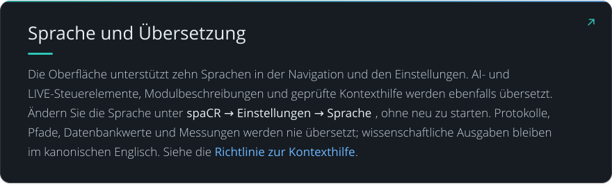ungen → Sprache, ohne neu zu starten. Protokolle, Pfade, Datenbankwerte und Messungen werden nie übersetzt; wissenschaftliche Ausgaben bleiben im kanonischen Englisch. Siehe die Richtlinie zur Kontexthilfe.
   :width: 100%
   :target: ../../source/localization.rst#contextual-help

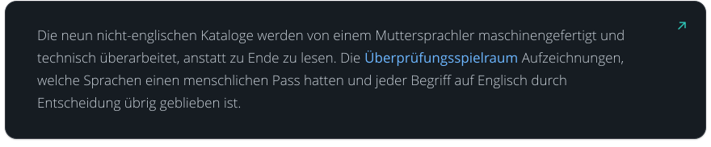lisch durch Entscheidung übrig geblieben ist.
   :width: 100%
   :target: ../REVIEW_SCOPE_2026-09-04.md

| |animated-setting-guidance-link-1|\ |animated-setting-guidance-link-2|

|DataBioStudies| |DataHuggingFace| |DataNCBI| |DataSpaCRPower| |DataBioRxiv|

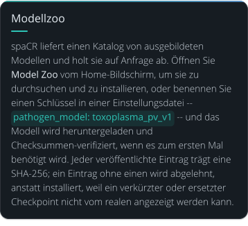del: toxoplasma_pv_v1 -- und das Modell wird heruntergeladen und Checksummen-verifiziert, wenn es zum ersten Mal benötigt wird. Jeder veröffentlichte Eintrag trägt eine SHA-256; ein Eintrag ohne einen wird abgelehnt, anstatt installiert, weil ein verkürzter oder ersetzter Checkpoint nicht vom realen angezeigt werden kann.
   :width: 100%

.. spacr-model-zoo-begin

| |zoo_heading|
| |zoo_card_toxoplasma_pv_v4|\ |zoo_card_toxoplasma_plaque_v4|
| |zoo_card_toxoplasma_well_detector_v3|\ |zoo_card_toxoplasma_from_cellmask_v1|
| |zoo_card_live_cell_v1|\ |zoo_card_nuclei_from_cellmask_v1|
| |zoo_card_cell_from_hoechst_v1|\ |zoo_card_toxoplasma_from_hoechst_v1|

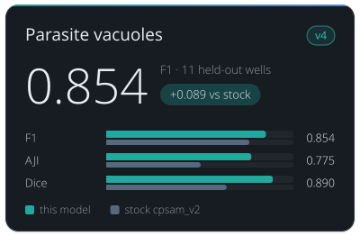

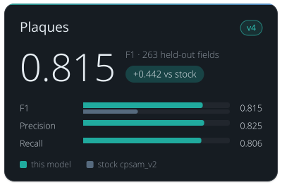

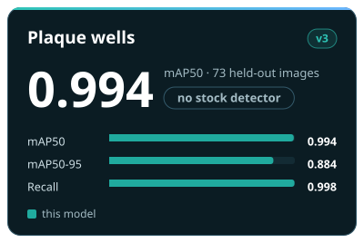

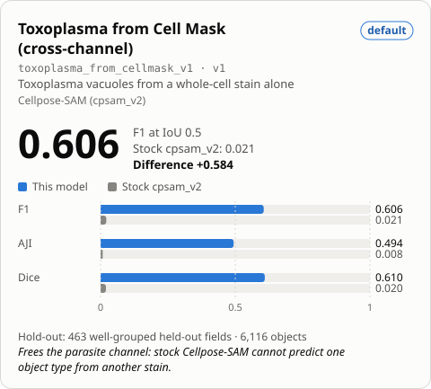

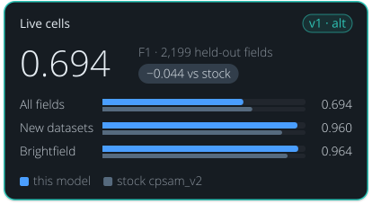 LIVECell.
   :target: ../../models/live_cell_v1.md
   :width: 49.5%

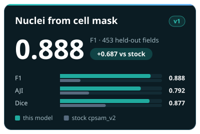

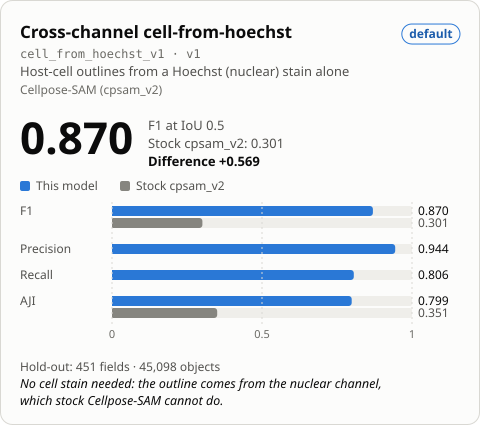

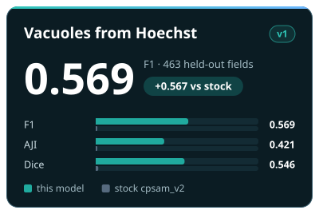

| |generated-model-zoo-1-link-1|\ |generated-model-zoo-1-link-2|\ |generated-model-zoo-1-link-3|
| |generated-model-zoo-1-link-4|\ |generated-model-zoo-1-link-5|\ |generated-model-zoo-1-link-6|
| |generated-model-zoo-1-link-7|

| |generated-model-zoo-2-link-1|\ |generated-model-zoo-2-link-2|

.. spacr-model-zoo-end

.. code-block:: bash

   python tools/spacr_hardware_report.py

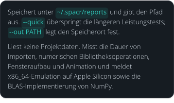meldet x86_64-Emulation auf Apple Silicon sowie die BLAS-Implementierung von NumPy.
   :width: 100%

.. code-block:: bash

   spacr              # the desktop application
   spacr-tutorial     # the interactive tutorial library
   spacr-server       # no first-run setup screen, for unattended launches

.. code-block:: bash

   spacr-doctor       # diagnose the installation and say how to fix it
   safespacr          # the least spaCR that can still change a setting

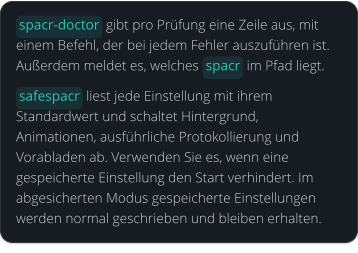n, ausführliche Protokollierung und Vorabladen ab. Verwenden Sie es, wenn eine gespeicherte Einstellung den Start verhindert. Im abgesicherten Modus gespeicherte Einstellungen werden normal geschrieben und bleiben erhalten.
   :width: 100%

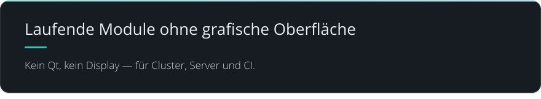

.. code-block:: bash

   spacr-run --list                              # modules with a headless entry
   spacr-run --describe MODULE                   # what a module consumes and produces
   spacr-run validate --module MODULE \
       --settings settings.csv                   # check settings before spending the run
   spacr-run MODULE --settings settings.csv      # execute
   spacr-remote --help                           # submit and monitor SSH, Slurm or cloud jobs

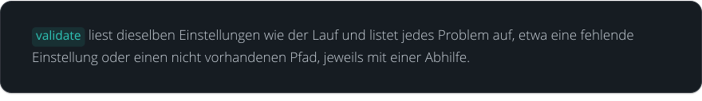

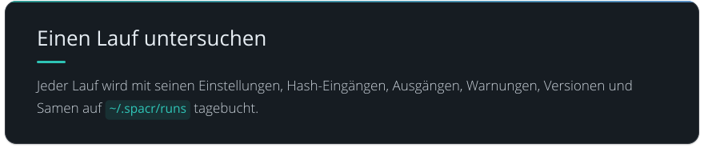

.. code-block:: bash

   spacr-repro RUN_DIR        # replay a recorded run from its journal
   spacr-workspace RUN_DIR    # what that run had open: databases, montages, views

.. code-block:: bash

   spacr-db-audit DB      # SQLite health, integrity, locking, reader/writer probe
   spacr-leakage          # classifier train/test leakage audit
   spacr-plugins          # installed plugin registry and failure diagnostics

.. code-block:: bash

   SPACR_LOG_LEVEL=DEBUG spacr      # verbose logging for one launch

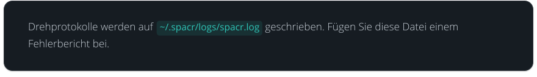

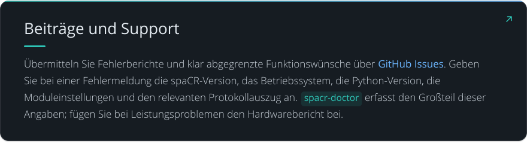auszug an. spacr-doctor erfasst den Großteil dieser Angaben; fügen Sie bei Leistungsproblemen den Hardwarebericht bei.
   :width: 100%
   :target: https://github.com/EinarOlafsson/spacr/issues

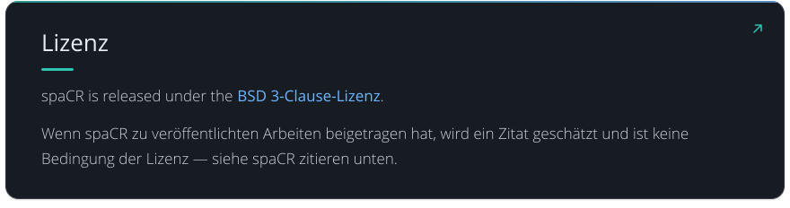

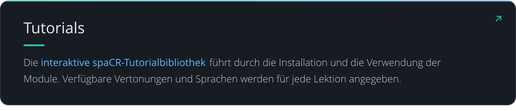

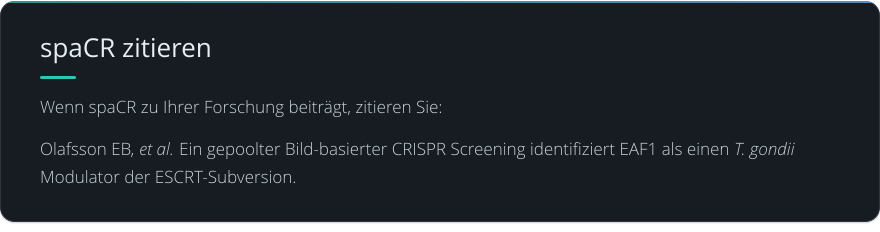

| |citing-spacr-2-1|\ |citing-spacr-2-2|

.. spacr-citing-papers-begin

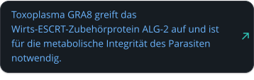

.. spacr-citing-papers-end

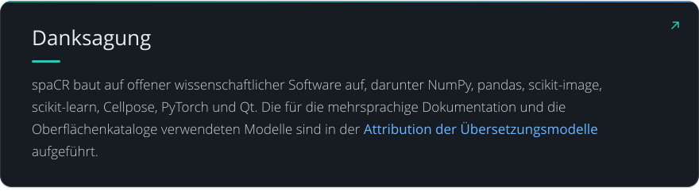on der Übersetzungsmodelle aufgeführt.
   :width: 100%
   :target: ../TRANSLATION_MODELS.md
