|Website| |Platforms| |Python| |Qt| |Test counts| |Coverage| |Issues| |Conda| |PyPI| |Docker| |PyPI Downloads| |Docs| |Tutorials| |Preprint| |DOI| |Cite| |License| |PyPI rank|

.. |Website| image:: https://img.shields.io/badge/Website-spaCR-0A7BBB
   :target: https://einarolafsson.github.io/projects/spacr/
   :alt: Vefsíða spaCR

.. |Docs| image:: https://img.shields.io/github/actions/workflow/status/EinarOlafsson/spacr/pages%2Fpages-build-deployment?label=API&logo=readthedocs&logoColor=white
   :target: https://einarolafsson.github.io/spacr/
   :alt: API-skjöl

.. |Tutorials| image:: https://img.shields.io/badge/Tutorials-4A9EFF
   :target: https://einarolafsson.github.io/spacr/tutorials/
   :alt: Gagnvirkt kennsluefni

.. |PyPI| image:: https://img.shields.io/pypi/v/spacr?label=PyPI&logo=pypi&logoColor=white
   :target: https://pypi.org/project/spacr/
   :alt: PyPI-útgáfa

.. |Python| image:: https://img.shields.io/badge/Python-3.9%E2%80%933.14-3776AB?logo=python&logoColor=white
   :target: https://pypi.org/project/spacr/
   :alt: Python 3.9 til 3.14

.. |Coverage| image:: https://img.shields.io/codecov/c/github/EinarOlafsson/spacr/nightly?logo=codecov&logoColor=white
   :target: https://app.codecov.io/github/EinarOlafsson/spacr
   :alt: Prófunarþekja á Codecov

.. |Test counts| image:: https://img.shields.io/endpoint?url=https%3A%2F%2Fraw.githubusercontent.com%2FEinarOlafsson%2Fspacr%2Fnightly%2Fdocs%2Fsource%2F_static%2Ftest-counts.json&cacheSeconds=300&logo=pytest&logoColor=white
   :target: https://github.com/EinarOlafsson/spacr/actions/workflows/tests.yml
   :alt: Prófunarsafn

.. |Qt| image:: https://img.shields.io/badge/GUI-Qt-41CD52?logo=qt&logoColor=white
   :target: https://einarolafsson.github.io/spacr/api/spacr/qt/index.html#module-spacr.qt
   :alt: Qt-viðmót

.. |Issues| image:: https://img.shields.io/github/issues/EinarOlafsson/spacr?logo=github
   :target: https://github.com/EinarOlafsson/spacr/issues
   :alt: GitHub-mál

.. |License| image:: https://img.shields.io/badge/License-BSD--3-blue?logo=opensourceinitiative&logoColor=white
   :target: https://github.com/EinarOlafsson/spacr/blob/main/LICENSE
   :alt: BSD 3-Clause-leyfi

.. |Preprint| image:: https://img.shields.io/badge/bioRxiv-BF2636
   :target: https://www.biorxiv.org/content/10.64898/2026.07.08.737057v1
   :alt: bioRxiv-forprentun

.. |DOI| image:: https://img.shields.io/badge/DOI-blue?logo=zenodo&logoColor=white
   :target: https://doi.org/10.5281/zenodo.21343316
   :alt: Zenodo DOI

.. |Conda| image:: https://img.shields.io/conda/vn/conda-forge/spacr?label=Conda&logo=anaconda&logoColor=white
   :target: https://anaconda.org/conda-forge/spacr
   :alt: conda-forge-útgáfa

.. |Release date| image:: https://anaconda.org/conda-forge/spacr/badges/latest_release_date.svg
   :target: https://anaconda.org/conda-forge/spacr
   :alt: Dagsetning nýjustu útgáfu á conda-forge

.. |Docker| image:: https://img.shields.io/badge/Docker-GHCR-2496ED?logo=docker&logoColor=white
   :target: https://github.com/EinarOlafsson/spacr/pkgs/container/spacr
   :alt: Docker-myndir á GHCR

.. |PyPI Downloads| image:: https://img.shields.io/pepy/dt/spacr?label=downloads&logo=pypi&logoColor=white
   :target: https://pepy.tech/projects/spacr
   :alt: PyPI-niðurhal

.. |Platforms| image:: https://img.shields.io/badge/Linux%20OSX%20Win-lightgrey?logo=linux&logoColor=white
   :target: https://github.com/EinarOlafsson/spacr/blob/nightly/docs/source/installers.rst
   :alt: Linux, macOS og Windows

.. |Cite| image:: https://img.shields.io/badge/Cite-8A2BE2
   :target: https://github.com/EinarOlafsson/spacr/blob/main/CITATION.cff
   :alt: Vitna í spaCR

.. |PyPI rank| image:: https://img.shields.io/badge/dynamic/json?url=https%3A%2F%2Fsql-clickhouse.clickhouse.com%2F%3Fuser%3Ddemo%26param_package_name%3Dspacr%26param_days%3D30%26query%3DWITH%2B%2528%2BSELECT%2Bsum%2528count%2529%2BFROM%2Bpypi.pypi_downloads_per_day%2BWHERE%2Bproject%2B%253D%2B%257Bpackage_name%253AString%257D%2BAND%2Bdate%2B%253E%253D%2BtoDate%2528now%2528%2527UTC%2527%2529%2529%2B-%2B%257Bdays%253AUInt16%257D%2BAND%2Bdate%2B%253C%2BtoDate%2528now%2528%2527UTC%2527%2529%2529%2B%2529%2BAS%2Bdownloads%2BSELECT%2Bdownloads%2BAS%2Bpackage_downloads%252C%2BcountIf%2528n%2B%253E%253D%2Bdownloads%2529%2BAS%2Brank%252C%2Bcount%2528%2529%2BAS%2Btotal_packages%252C%2B100.0%2B%252A%2Brank%2B%252F%2BnullIf%2528total_packages%252C%2B0%2529%2BAS%2Bpercentile%252C%2Bif%2528%2Btotal_packages%2B%253D%2B0%2BOR%2Bdownloads%2B%253D%2B0%252C%2B%2527no%2Bdata%2527%252C%2Bconcat%2528%2B%2527top%2B%2527%252C%2BtoString%2528ceil%25281000.0%2B%252A%2Brank%2B%252F%2BnullIf%2528total_packages%252C%2B0%2529%2529%2B%252F%2B10%2529%252C%2B%2527%2525%2527%2B%2529%2B%2529%2BAS%2Bmessage%2BFROM%2B%2528%2BSELECT%2Bproject%252C%2Bsum%2528count%2529%2BAS%2Bn%2BFROM%2Bpypi.pypi_downloads_per_day%2BWHERE%2Bdate%2B%253E%253D%2BtoDate%2528now%2528%2527UTC%2527%2529%2529%2B-%2B%257Bdays%253AUInt16%257D%2BAND%2Bdate%2B%253C%2BtoDate%2528now%2528%2527UTC%2527%2529%2529%2BGROUP%2BBY%2Bproject%2B%2529%2BFORMAT%2BJSON&query=%24.data%5B0%5D.message&label=Rank&color=brightgreen&logo=pypi&logoColor=white&cacheSeconds=86400
   :target: https://clickpy.clickhouse.com/dashboard/spacr
   :alt: Röðun spaCR eftir PyPI-niðurhali síðustu 30 heilu dagana

.. image:: ../../source/_static/deck/slides/slide_01.jpg
   :alt: spaCR
   :width: 920
   :target: https://einarolafsson.github.io/spacr/_static/deck/

| |intro-1|\ |intro-2|

.. spacr-language-picker-begin

.. spacr-language-picker-end

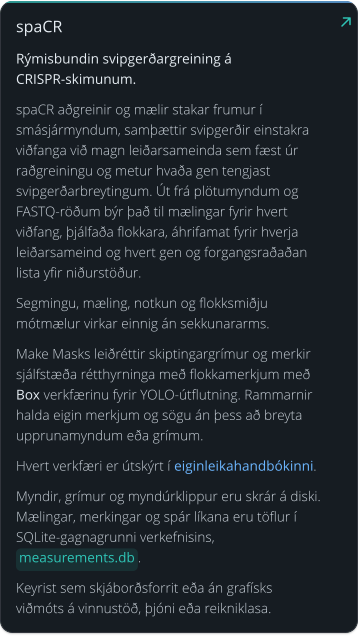frá plötumyndum og FASTQ-röðum býr það til mælingar fyrir hvert viðfang, þjálfaða flokkara, áhrifamat fyrir hverja leiðarsameind og hvert gen og forgangsraðaðan lista yfir niðurstöður. Segmingu, mæling, notkun og flokksmiðju mótmælur virkar einnig án sekkunararms. Make Masks leiðréttir skiptingargrímur og merkir sjálfstæða rétthyrninga með flokkamerkjum með Box verkfærinu fyrir YOLO-útflutning. Rammarnir halda eigin merkjum og sögu án þess að breyta upprunamyndum eða grímum. Hvert verkfæri er útskýrt í eiginleikahandbókinni. Myndir, grímur og myndúrklippur eru skrár á diski. Mælingar, merkingar og spár líkana eru töflur í SQLite-gagnagrunni verkefnisins, measurements.db. Keyrist sem skjáborðsforrit eða án grafísks viðmóts á vinnustöð, þjóni eða reikniklasa.
   :width: 100%
   :target: ../../source/features.rst

.. code-block:: bash

   conda create -n spacr python=3.12 -y
   conda activate spacr
   python -m pip install spacr
   spacr

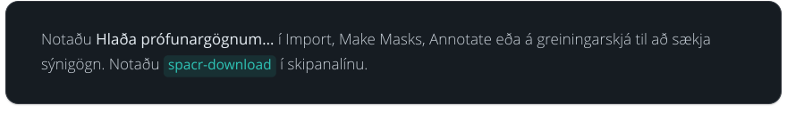

.. spacr-hardware-begin

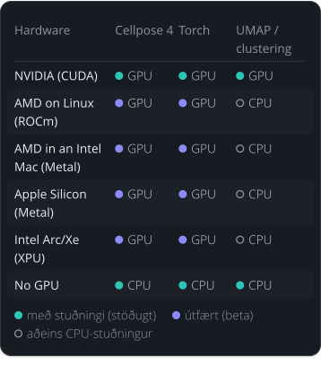

.. spacr-hardware-end

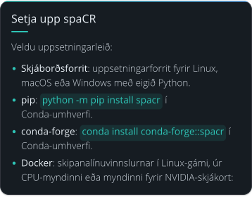

.. code-block:: bash

   docker run --rm ghcr.io/einarolafsson/spacr:1.5.1.4 spacr-run --list
   docker run --rm --gpus all ghcr.io/einarolafsson/spacr:1.5.1.4-cuda12.4 spacr-run --list

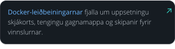

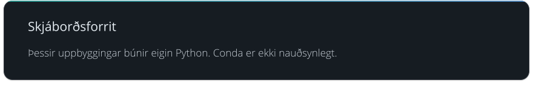

.. spacr-installer-links-begin

|InstallerLinux| |InstallerMacOS| |InstallerWindows|

.. |InstallerWindows| image:: ../../../spacr/resources/icons/platforms/windows.png
   :width: 64
   :alt: Sækja spaCR 1.5.1.4 fyrir Windows 10/11
   :target: https://github.com/EinarOlafsson/spacr/releases/download/v1.5.1.4/spaCR-1.5.1.4-Windows-Online-Setup.exe
.. |InstallerMacOS| image:: ../../../spacr/resources/icons/platforms/macos.png
   :width: 64
   :alt: Sækja spaCR 1.5.1.4 fyrir macOS 11+ (Intel og Apple Silicon)
   :target: https://github.com/EinarOlafsson/spacr/releases/download/v1.5.1.4/spaCR-1.5.1.4-macOS-Universal-Online.pkg
.. |InstallerLinux| image:: ../../../spacr/resources/icons/platforms/linux.png
   :width: 64
   :alt: Sækja spaCR 1.5.1.4 fyrir 64-bita Linux
   :target: https://github.com/EinarOlafsson/spacr/releases/download/v1.5.1.4/spaCR-1.5.1.4-Linux-x86_64-Online.run

.. spacr-installer-links-end

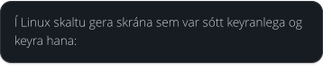

.. code-block:: bash

   chmod +x SpaCR-*-Linux-x86_64-Online.run
   ./SpaCR-*-Linux-x86_64-Online.run

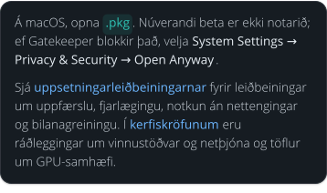ngu. Í kerfiskröfunum eru ráðleggingar um vinnustöðvar og netþjóna og töflur um GPU-samhæfi.
   :width: 100%

| |desktop-application-3-link-1|\ |desktop-application-3-link-2|

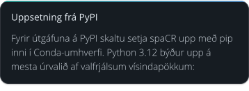

.. code-block:: bash

   conda create -n spacr python=3.12 -y
   conda activate spacr
   python -m pip install --upgrade pip
   python -m pip install spacr
   spacr

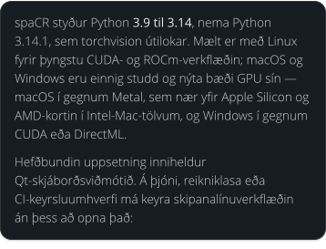in í Intel-Mac-tölvum, og Windows í gegnum CUDA eða DirectML. Hefðbundin uppsetning inniheldur Qt-skjáborðsviðmótið. Á þjóni, reikniklasa eða CI-keyrsluumhverfi má keyra skipanalínuverkflæðin án þess að opna það:
   :width: 100%

.. code-block:: bash

   python -m pip install spacr
   spacr-run --list

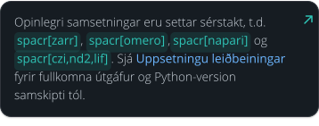

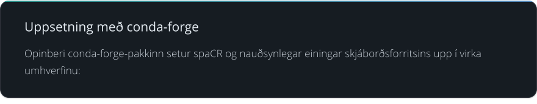

.. code-block:: bash

   conda create -n spacr python=3.12 -y
   conda activate spacr
   conda install conda-forge::spacr
   spacr

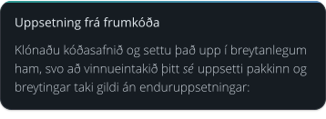

.. code-block:: bash

   git clone https://github.com/EinarOlafsson/spacr.git
   cd spacr
   conda create -n spacr python=3.12 -y
   conda activate spacr
   pip install -e .
   spacr

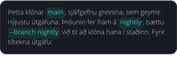

.. code-block:: bash

   git clone --branch v1.5.0.5 https://github.com/EinarOlafsson/spacr.git

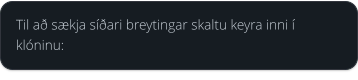

.. code-block:: bash

   git pull
   pip install -e .

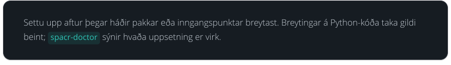

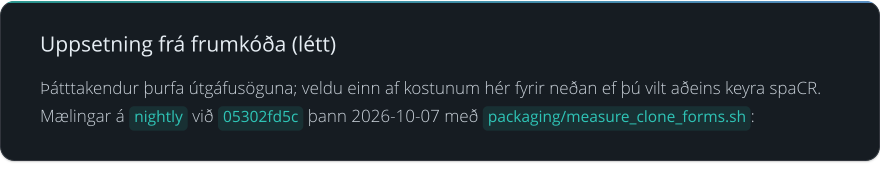

.. code-block:: bash

   # One commit instead of every version: 2048 MB downloaded, 140 s.
   # No history, so no git log, no git blame and no git bisect.
   # git pull still works, but stays shallow until git fetch --unshallow.
   git clone --depth 1 --branch nightly https://github.com/EinarOlafsson/spacr.git
   cd spacr && pip install -e .

   # Runtime files: 104 MB on disk, 6 s (Git: 38 MB; files: 66 MB).
   # No history, docs, tests, tools, features or example data.
   # --with-docs, --with-tests and --with-translations put those back;
   # --dir, --branch, --no-install and --help do the obvious things.
   # packaging/source_install_excludes.txt lists every skipped path.
   curl -fsSL https://raw.githubusercontent.com/EinarOlafsson/spacr/nightly/packaging/install_from_source.sh -o install_spacr.sh
   sh install_spacr.sh --branch nightly

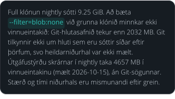eru mismunandi eftir grein.
   :width: 100%

.. code-block:: bash

   spacr                                      # launch the Qt application
   spacr-doctor                               # diagnose the installation
   spacr-run --list                           # list headless modules
   spacr-run --describe MODULE                # inspect a module contract
   spacr-run MODULE --settings settings.csv   # execute a module
   spacr-run validate --module MODULE \
       --settings settings.csv                # validate before running
   spacr-repro RUN_DIR                        # replay a recorded run
   spacr-download --list                      # what example data exists
   spacr-download measure annotate            # fetch example sets by name
   spacr-make-masks --folder DIR              # curate masks as a resumable queue
   spacr-make-masks --folder DIR --order easy --limit 50

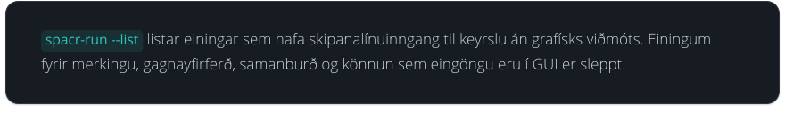

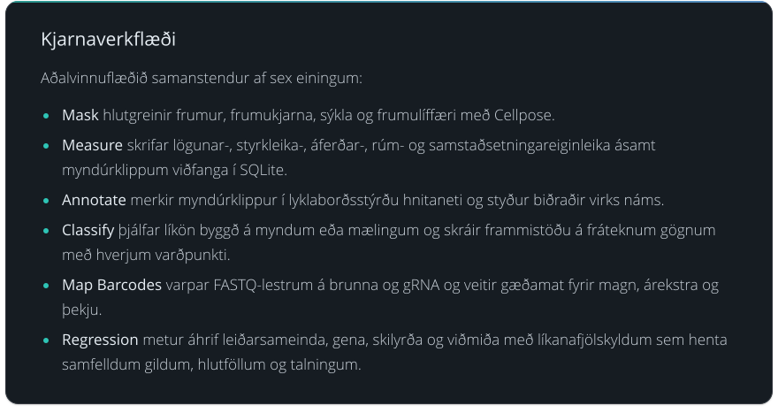 og styður biðraðir virks náms. Classify þjálfar líkön byggð á myndum eða mælingum og skráir frammistöðu á fráteknum gögnum með hverjum varðpunkti. Map Barcodes varpar FASTQ-lestrum á brunna og gRNA og veitir gæðamat fyrir magn, árekstra og þekju. Regression metur áhrif leiðarsameinda, gena, skilyrða og viðmiða með líkanafjölskyldum sem henta samfelldum gildum, hlutföllum og talningum.
   :width: 100%

.. spacr-workflow-begin

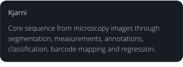

| |Module_mask|\ |Module_measure|\ |Module_annotate|\ |Module_classify_merged|\ |Module_map_barcodes|\ |Module_regression|

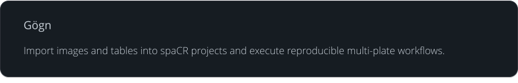

| |Module_foreign|\ |Module_embeddings|\ |Module_run_compare|\ |Module_experiment_design|\ |Module_power|\ |Module_dose_response|
| |Module_qc_dashboard|

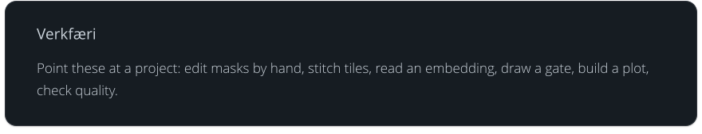

| |Module_make_masks|\ |Module_align|\ |Module_umap|\ |Module_gate_editor|\ |Module_graph_builder|

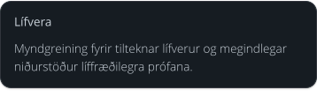

| |Module_toxoplasma|

.. |Module_mask| raw:: html

   

.. |Module_measure| raw:: html

   

.. |Module_annotate| raw:: html

   

.. |Module_classify_merged| raw:: html

   

.. |Module_map_barcodes| raw:: html

   

.. |Module_regression| raw:: html

   

.. |Module_foreign| raw:: html

   

.. |Module_embeddings| raw:: html

   

.. |Module_run_compare| raw:: html

   

.. |Module_experiment_design| raw:: html

   

.. |Module_power| raw:: html

   

.. |Module_dose_response| raw:: html

   

.. |Module_qc_dashboard| raw:: html

   

.. |Module_make_masks| raw:: html

   

.. |Module_align| raw:: html

   

.. |Module_umap| raw:: html

   

.. |Module_gate_editor| raw:: html

   

.. |Module_graph_builder| raw:: html

   

.. |Module_toxoplasma| raw:: html

   

.. spacr-workflow-end

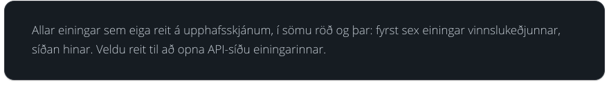

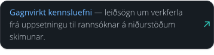

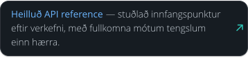

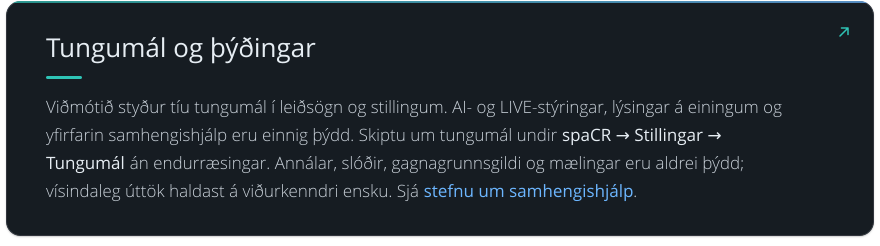gagnagrunnsgildi og mælingar eru aldrei þýdd; vísindaleg úttök haldast á viðurkenndri ensku. Sjá stefnu um samhengishjálp.
   :width: 100%
   :target: ../../source/localization.rst#contextual-help

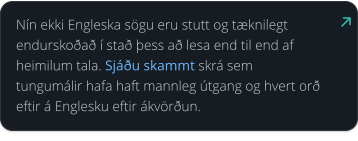

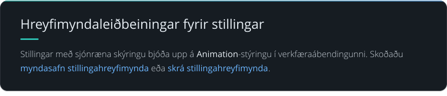

| |animated-setting-guidance-link-1|\ |animated-setting-guidance-link-2|

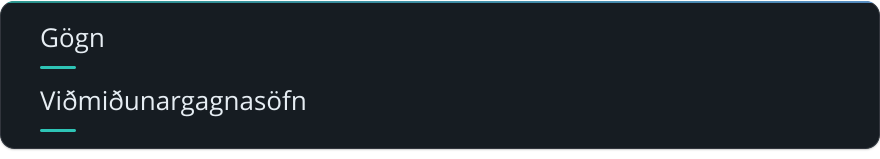

|DataBioStudies| |DataHuggingFace| |DataNCBI| |DataSpaCRPower| |DataBioRxiv|

.. |DataBioStudies| image:: ../../../spacr/resources/icons/databanks/biostudies_button.png
   :width: 72
   :alt: Opna smásjárgagnasafnið í BioStudies
   :target: https://doi.org/10.6019/S-BIAD2135

.. |DataHuggingFace| image:: ../../../spacr/resources/icons/databanks/huggingface_button.png
   :width: 72
   :alt: Opna prófunargagnasafnið á Hugging Face
   :target: https://huggingface.co/datasets/einarolafsson/toxo_mito

.. |DataNCBI| image:: ../../../spacr/resources/icons/databanks/ncbi_button.png
   :width: 72
   :alt: Opna raðgreiningargagnasafnið hjá NCBI
   :target: https://www.ncbi.nlm.nih.gov/bioproject/?term=PRJNA1261935

.. |DataSpaCRPower| image:: ../../../spacr/resources/icons/databanks/spacrpower_button.png
   :width: 72
   :alt: Opna spaCRPower
   :target: https://github.com/maomlab/spaCRPower

.. |DataBioRxiv| image:: ../../../spacr/resources/icons/databanks/biorxiv_button.png
   :width: 72
   :alt: Opna bioRxiv-forprentið
   :target: https://www.biorxiv.org/content/10.64898/2026.07.08.737057v1

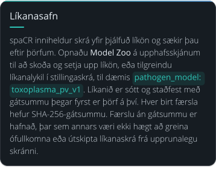

.. spacr-model-zoo-begin

| |zoo_heading|
| |zoo_card_toxoplasma_pv_v4|\ |zoo_card_toxoplasma_plaque_v4|
| |zoo_card_toxoplasma_well_detector_v3|\ |zoo_card_toxoplasma_from_cellmask_v1|
| |zoo_card_live_cell_v1|\ |zoo_card_nuclei_from_cellmask_v1|
| |zoo_card_cell_from_hoechst_v1|\ |zoo_card_toxoplasma_from_hoechst_v1|

.. |zoo_heading| image:: ../../models/cards/heading.svg
   :alt: Default models · held-out scores
   :target: ../../models/README.md
   :width: 99.5%

.. |zoo_card_toxoplasma_pv_v4| image:: ../../models/cards/toxoplasma_pv_v4.svg
   :alt: Score card of Parasite vacuoles v4 (toxoplasma_pv_v4, default): F1 0.761 on 209 held-out fields against 0.377 for stock cpsam_v2. F1 0.761 against stock cpsam_v2's 0.377 on the 209 strict hold-out fields at IoU 0.5; AJI 0.582 against 0.040.
   :target: ../../models/toxoplasma_pv_v4.md
   :width: 49.5%

.. |zoo_card_toxoplasma_plaque_v4| image:: ../../models/cards/toxoplasma_plaque_v4.svg
   :alt: Score card of Plaques v4 (toxoplasma_plaque_v4, default): F1 0.765 on 329 held-out fields against 0.338 for stock cpsam_v2. F1 0.765 against stock cpsam_v2's 0.338 on the 329 strict hold-out fields at IoU 0.5; AJI 0.662 against 0.261.
   :target: ../../models/toxoplasma_plaque_v4.md
   :width: 49.5%

.. |zoo_card_toxoplasma_well_detector_v3| image:: ../../models/cards/toxoplasma_well_detector_v3.svg
   :alt: Score card of Plaque wells v3 (toxoplasma_well_detector_v3, default): mAP50 0.994 on 73 held-out images. Stock was not evaluated in this run; see the named incumbent comparison on the model card.
   :target: ../../models/toxoplasma_well_detector_v3.md
   :width: 49.5%

.. |zoo_card_toxoplasma_from_cellmask_v1| image:: ../../models/cards/toxoplasma_from_cellmask_v1.svg
   :alt: Score card of Vacuoles from cell mask v1 (toxoplasma_from_cellmask_v1, default): F1 0.606 on 463 held-out fields against 0.021 for stock cpsam_v2. F1 0.606 against 0.021 for stock cpsam_v2 on 463 well-grouped held-out fields, at IoU 0.5.
   :target: ../../models/toxoplasma_from_cellmask_v1.md
   :width: 49.5%

.. |zoo_card_live_cell_v1| image:: ../../models/cards/live_cell_v1.svg
   :alt: Score card of Live cells v1 (live_cell_v1, default): F1 0.694 on 2,199 held-out fields against 0.738 for stock cpsam_v2. On the datasets stock cpsam_v2 never trained on, F1 0.960 against 0.885 at IoU 0.5; over all 2,199 test fields, 0.694 against 0.738, because stock trained on LIVECell and YeaZ and wins on LIVECell.
   :target: ../../models/live_cell_v1.md
   :width: 49.5%

.. |zoo_card_nuclei_from_cellmask_v1| image:: ../../models/cards/nuclei_from_cellmask_v1.svg
   :alt: Score card of Nuclei from cell mask v1 (nuclei_from_cellmask_v1, default): F1 0.888 on 453 held-out fields against 0.201 for stock cpsam_v2. F1 0.888 against 0.201 for stock cpsam_v2 on 453 well-grouped held-out fields, at IoU 0.5.
   :target: ../../models/nuclei_from_cellmask_v1.md
   :width: 49.5%

.. |zoo_card_cell_from_hoechst_v1| image:: ../../models/cards/cell_from_hoechst_v1.svg
   :alt: Score card of Cells from Hoechst v1 (cell_from_hoechst_v1, default): F1 0.870 on 451 held-out fields against 0.301 for stock cpsam_v2. F1 0.870 against stock cpsam_v2's 0.301 on 451 held-out fields at IoU 0.5 -- a delta of 0.569.
   :target: ../../models/cell_from_hoechst_v1.md
   :width: 49.5%

.. |zoo_card_toxoplasma_from_hoechst_v1| image:: ../../models/cards/toxoplasma_from_hoechst_v1.svg
   :alt: Score card of Vacuoles from Hoechst v1 (toxoplasma_from_hoechst_v1, default): F1 0.569 on 463 held-out fields against 0.002 for stock cpsam_v2. F1 0.569 against 0.002 for stock cpsam_v2 on 463 well-grouped held-out fields, at IoU 0.5.
   :target: ../../models/toxoplasma_from_hoechst_v1.md
   :width: 49.5%

| |generated-model-zoo-1-link-1|\ |generated-model-zoo-1-link-2|\ |generated-model-zoo-1-link-3|
| |generated-model-zoo-1-link-4|\ |generated-model-zoo-1-link-5|\ |generated-model-zoo-1-link-6|
| |generated-model-zoo-1-link-7|

.. |generated-model-zoo-1-link-5| image:: ../../readme_images/is/generated-model-zoo-1-link-5.svg
   :alt: toxoplasma_plaque_v1
   :width: 32.8%
   :target: ../../models/toxoplasma_plaque_v1.md

.. |generated-model-zoo-1-link-6| image:: ../../readme_images/is/generated-model-zoo-1-link-6.svg
   :alt: toxoplasma_well_detector_v2
   :width: 32.8%
   :target: ../../models/toxoplasma_well_detector_v2.md

| |generated-model-zoo-2-link-1|\ |generated-model-zoo-2-link-2|

.. spacr-model-zoo-end

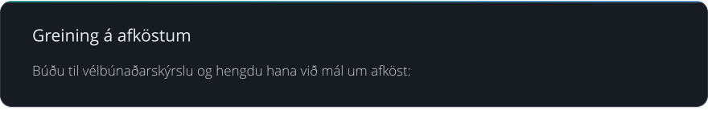

.. code-block:: bash

   python tools/spacr_hardware_report.py

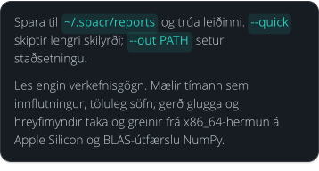on og BLAS-útfærslu NumPy.
   :width: 100%

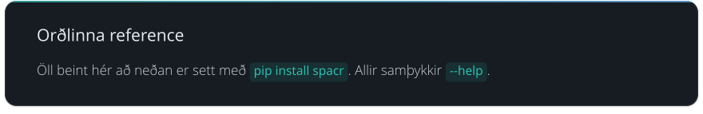

.. code-block:: bash

   spacr              # the desktop application
   spacr-tutorial     # the interactive tutorial library
   spacr-server       # no first-run setup screen, for unattended launches

.. code-block:: bash

   spacr-doctor       # diagnose the installation and say how to fix it
   safespacr          # the least spaCR that can still change a setting

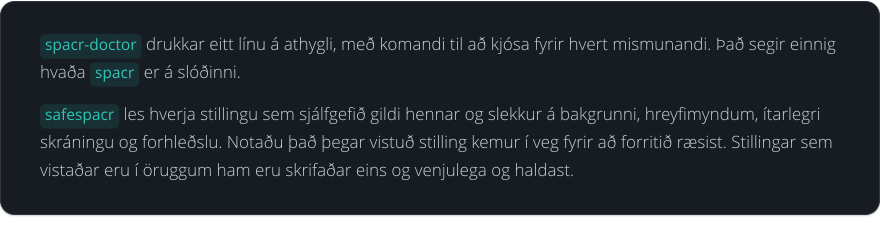forhleðslu. Notaðu það þegar vistuð stilling kemur í veg fyrir að forritið ræsist. Stillingar sem vistaðar eru í öruggum ham eru skrifaðar eins og venjulega og haldast.
   :width: 100%

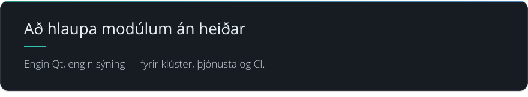

.. code-block:: bash

   spacr-run --list                              # modules with a headless entry
   spacr-run --describe MODULE                   # what a module consumes and produces
   spacr-run validate --module MODULE \
       --settings settings.csv                   # check settings before spending the run
   spacr-run MODULE --settings settings.csv      # execute
   spacr-remote --help                           # submit and monitor SSH, Slurm or cloud jobs

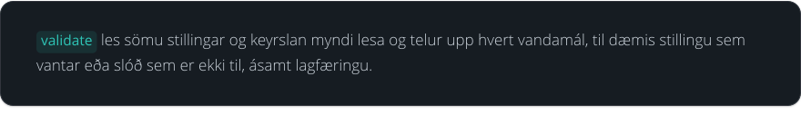

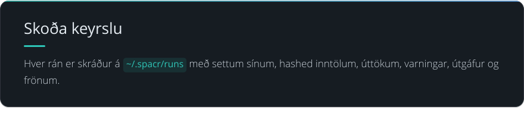

.. code-block:: bash

   spacr-repro RUN_DIR        # replay a recorded run from its journal
   spacr-workspace RUN_DIR    # what that run had open: databases, montages, views

.. code-block:: bash

   spacr-db-audit DB      # SQLite health, integrity, locking, reader/writer probe
   spacr-leakage          # classifier train/test leakage audit
   spacr-plugins          # installed plugin registry and failure diagnostics

.. code-block:: bash

   SPACR_LOG_LEVEL=DEBUG spacr      # verbose logging for one launch

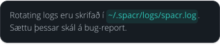

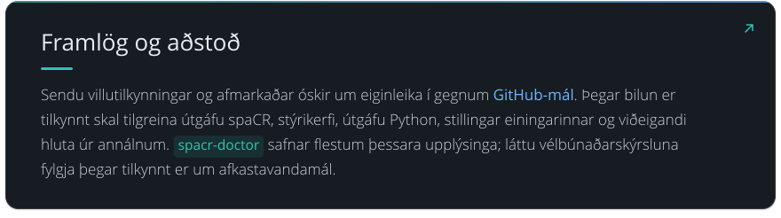 flestum þessara upplýsinga; láttu vélbúnaðarskýrsluna fylgja þegar tilkynnt er um afkastavandamál.
   :width: 100%
   :target: https://github.com/EinarOlafsson/spacr/issues

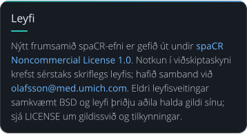

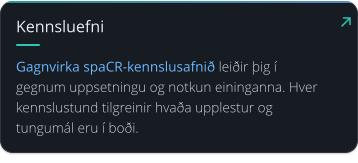

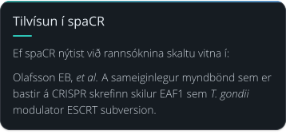

| |citing-spacr-2-1|\ |citing-spacr-2-2|

.. spacr-citing-papers-begin

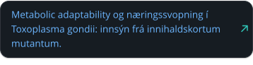

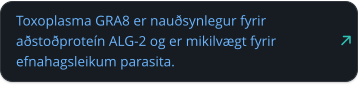

.. spacr-citing-papers-end

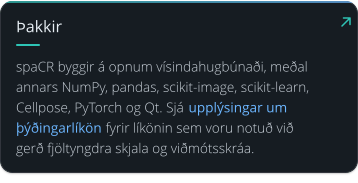
