|Website| |Platforms| |Python| |Qt| |Test counts| |Coverage| |Issues| |Conda| |PyPI| |Docker| |PyPI Downloads| |Docs| |Tutorials| |Preprint| |DOI| |Cite| |License| |PyPI rank|

.. |Website| image:: https://img.shields.io/badge/Website-spaCR-0A7BBB
   :target: https://einarolafsson.github.io/projects/spacr/
   :alt: spaCR:s webbplats

.. |Docs| image:: https://img.shields.io/github/actions/workflow/status/EinarOlafsson/spacr/pages%2Fpages-build-deployment?label=API&logo=readthedocs&logoColor=white
   :target: https://einarolafsson.github.io/spacr/
   :alt: API-dokumentation

.. |Tutorials| image:: https://img.shields.io/badge/Tutorials-4A9EFF
   :target: https://einarolafsson.github.io/spacr/tutorials/
   :alt: Interaktiva handledningar

.. |PyPI| image:: https://img.shields.io/pypi/v/spacr?label=PyPI&logo=pypi&logoColor=white
   :target: https://pypi.org/project/spacr/
   :alt: PyPI-version

.. |Python| image:: https://img.shields.io/badge/Python-3.9%E2%80%933.14-3776AB?logo=python&logoColor=white
   :target: https://pypi.org/project/spacr/
   :alt: Python 3.9 till 3.14

.. |Coverage| image:: https://img.shields.io/codecov/c/github/EinarOlafsson/spacr/nightly?logo=codecov&logoColor=white
   :target: https://app.codecov.io/github/EinarOlafsson/spacr
   :alt: Testtäckning på Codecov

.. |Test counts| image:: https://img.shields.io/endpoint?url=https%3A%2F%2Fraw.githubusercontent.com%2FEinarOlafsson%2Fspacr%2Fnightly%2Fdocs%2Fsource%2F_static%2Ftest-counts.json&cacheSeconds=300&logo=pytest&logoColor=white
   :target: https://github.com/EinarOlafsson/spacr/actions/workflows/tests.yml
   :alt: Testsvit

.. |Qt| image:: https://img.shields.io/badge/GUI-Qt-41CD52?logo=qt&logoColor=white
   :target: https://einarolafsson.github.io/spacr/api/spacr/qt/index.html#module-spacr.qt
   :alt: Qt-gränssnitt

.. |Issues| image:: https://img.shields.io/github/issues/EinarOlafsson/spacr?logo=github
   :target: https://github.com/EinarOlafsson/spacr/issues
   :alt: GitHub-ärenden

.. |License| image:: https://img.shields.io/badge/License-BSD--3-blue?logo=opensourceinitiative&logoColor=white
   :target: https://github.com/EinarOlafsson/spacr/blob/main/LICENSE
   :alt: BSD 3-Clause-licens

.. |Preprint| image:: https://img.shields.io/badge/bioRxiv-BF2636
   :target: https://www.biorxiv.org/content/10.64898/2026.07.08.737057v1
   :alt: bioRxiv-preprint

.. |DOI| image:: https://img.shields.io/badge/DOI-blue?logo=zenodo&logoColor=white
   :target: https://doi.org/10.5281/zenodo.21343316
   :alt: Zenodo-DOI

.. |Conda| image:: https://img.shields.io/conda/vn/conda-forge/spacr?label=Conda&logo=anaconda&logoColor=white
   :target: https://anaconda.org/conda-forge/spacr
   :alt: conda-forge-version

.. |Release date| image:: https://anaconda.org/conda-forge/spacr/badges/latest_release_date.svg
   :target: https://anaconda.org/conda-forge/spacr
   :alt: Datum för senaste conda-forge-versionen

.. |Docker| image:: https://img.shields.io/badge/Docker-GHCR-2496ED?logo=docker&logoColor=white
   :target: https://github.com/EinarOlafsson/spacr/pkgs/container/spacr
   :alt: Docker-avbildningar på GHCR

.. |PyPI Downloads| image:: https://img.shields.io/pepy/dt/spacr?label=downloads&logo=pypi&logoColor=white
   :target: https://pepy.tech/projects/spacr
   :alt: PyPI-nedladdningar

.. |Platforms| image:: https://img.shields.io/badge/Linux%20OSX%20Win-lightgrey?logo=linux&logoColor=white
   :target: https://github.com/EinarOlafsson/spacr/blob/nightly/docs/source/installers.rst
   :alt: Linux, macOS och Windows

.. |Cite| image:: https://img.shields.io/badge/Cite-8A2BE2
   :target: https://github.com/EinarOlafsson/spacr/blob/main/CITATION.cff
   :alt: Citera spaCR

.. |PyPI rank| image:: https://img.shields.io/badge/dynamic/json?url=https%3A%2F%2Fsql-clickhouse.clickhouse.com%2F%3Fuser%3Ddemo%26param_package_name%3Dspacr%26param_days%3D30%26query%3DWITH%2B%2528%2BSELECT%2Bsum%2528count%2529%2BFROM%2Bpypi.pypi_downloads_per_day%2BWHERE%2Bproject%2B%253D%2B%257Bpackage_name%253AString%257D%2BAND%2Bdate%2B%253E%253D%2BtoDate%2528now%2528%2527UTC%2527%2529%2529%2B-%2B%257Bdays%253AUInt16%257D%2BAND%2Bdate%2B%253C%2BtoDate%2528now%2528%2527UTC%2527%2529%2529%2B%2529%2BAS%2Bdownloads%2BSELECT%2Bdownloads%2BAS%2Bpackage_downloads%252C%2BcountIf%2528n%2B%253E%253D%2Bdownloads%2529%2BAS%2Brank%252C%2Bcount%2528%2529%2BAS%2Btotal_packages%252C%2B100.0%2B%252A%2Brank%2B%252F%2BnullIf%2528total_packages%252C%2B0%2529%2BAS%2Bpercentile%252C%2Bif%2528%2Btotal_packages%2B%253D%2B0%2BOR%2Bdownloads%2B%253D%2B0%252C%2B%2527no%2Bdata%2527%252C%2Bconcat%2528%2B%2527top%2B%2527%252C%2BtoString%2528ceil%25281000.0%2B%252A%2Brank%2B%252F%2BnullIf%2528total_packages%252C%2B0%2529%2529%2B%252F%2B10%2529%252C%2B%2527%2525%2527%2B%2529%2B%2529%2BAS%2Bmessage%2BFROM%2B%2528%2BSELECT%2Bproject%252C%2Bsum%2528count%2529%2BAS%2Bn%2BFROM%2Bpypi.pypi_downloads_per_day%2BWHERE%2Bdate%2B%253E%253D%2BtoDate%2528now%2528%2527UTC%2527%2529%2529%2B-%2B%257Bdays%253AUInt16%257D%2BAND%2Bdate%2B%253C%2BtoDate%2528now%2528%2527UTC%2527%2529%2529%2BGROUP%2BBY%2Bproject%2B%2529%2BFORMAT%2BJSON&query=%24.data%5B0%5D.message&label=Rank&color=brightgreen&logo=pypi&logoColor=white&cacheSeconds=86400
   :target: https://clickpy.clickhouse.com/dashboard/spacr
   :alt: spaCR:s PyPI-nedladdningsranking de senaste 30 hela dygnen

.. image:: ../../source/_static/deck/slides/slide_01.jpg
   :alt: spaCR
   :width: 920
   :target: https://einarolafsson.github.io/spacr/_static/deck/

| |intro-1|\ |intro-2|

.. spacr-language-picker-begin

.. spacr-language-picker-end

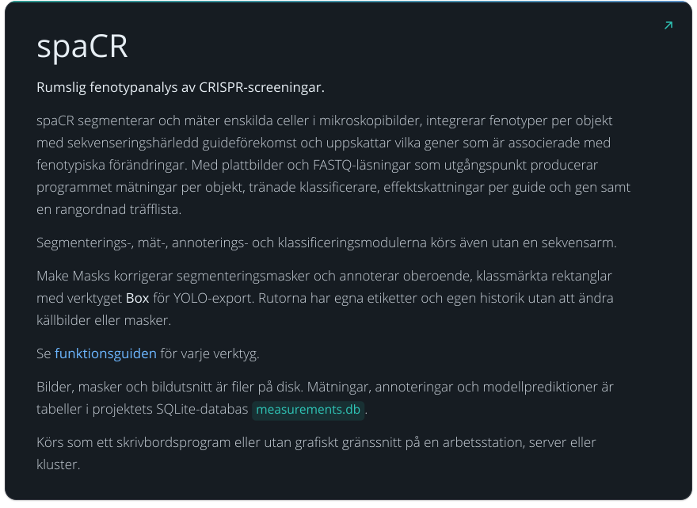dringar. Med plattbilder och FASTQ-läsningar som utgångspunkt producerar programmet mätningar per objekt, tränade klassificerare, effektskattningar per guide och gen samt en rangordnad träfflista. Segmenterings-, mät-, annoterings- och klassificeringsmodulerna körs även utan en sekvensarm. Make Masks korrigerar segmenteringsmasker och annoterar oberoende, klassmärkta rektanglar med verktyget Box för YOLO-export. Rutorna har egna etiketter och egen historik utan att ändra källbilder eller masker. Se funktionsguiden för varje verktyg. Bilder, masker och bildutsnitt är filer på disk. Mätningar, annoteringar och modellprediktioner är tabeller i projektets SQLite-databas measurements.db. Körs som ett skrivbordsprogram eller utan grafiskt gränssnitt på en arbetsstation, server eller kluster.
   :width: 99.5%
   :target: ../../source/features.rst

.. code-block:: bash

   conda create -n spacr python=3.12 -y
   conda activate spacr
   python -m pip install spacr
   spacr

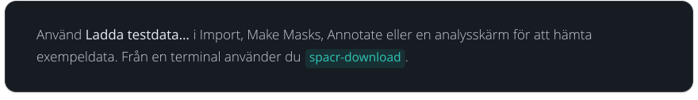

.. spacr-hardware-begin

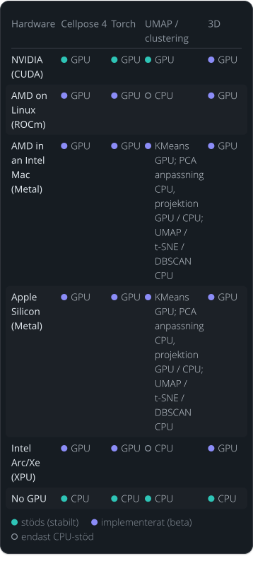

.. spacr-hardware-end

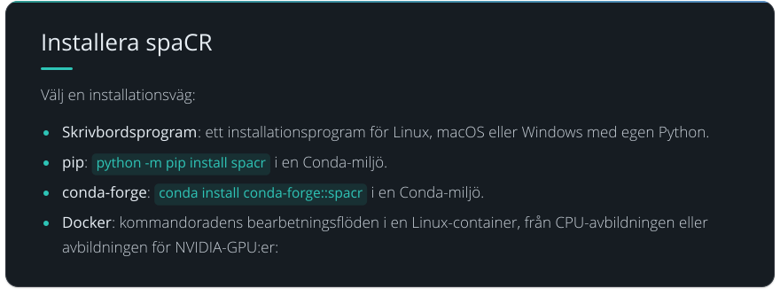

.. code-block:: bash

   docker run --rm ghcr.io/einarolafsson/spacr:1.5.1.4 spacr-run --list
   docker run --rm --gpus all ghcr.io/einarolafsson/spacr:1.5.1.4-cuda12.4 spacr-run --list

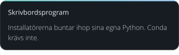

.. spacr-installer-links-begin

|InstallerLinux| |InstallerMacOS| |InstallerWindows|

.. |InstallerWindows| image:: ../../../spacr/resources/icons/platforms/windows.png
   :width: 64
   :alt: Hämta spaCR 1.5.1.4 för Windows 10/11
   :target: https://github.com/EinarOlafsson/spacr/releases/download/v1.5.1.4/spaCR-1.5.1.4-Windows-Online-Setup.exe
.. |InstallerMacOS| image:: ../../../spacr/resources/icons/platforms/macos.png
   :width: 64
   :alt: Hämta spaCR 1.5.1.4 för macOS 11+ (Intel och Apple Silicon)
   :target: https://github.com/EinarOlafsson/spacr/releases/download/v1.5.1.4/spaCR-1.5.1.4-macOS-Universal-Online.pkg
.. |InstallerLinux| image:: ../../../spacr/resources/icons/platforms/linux.png
   :width: 64
   :alt: Hämta spaCR 1.5.1.4 för 64-bitars Linux
   :target: https://github.com/EinarOlafsson/spacr/releases/download/v1.5.1.4/spaCR-1.5.1.4-Linux-x86_64-Online.run

.. spacr-installer-links-end

.. code-block:: bash

   chmod +x SpaCR-*-Linux-x86_64-Online.run
   ./SpaCR-*-Linux-x86_64-Online.run

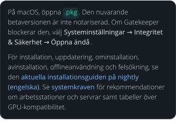ch systemkraven för rekommendationer om arbetsstationer och servrar samt tabeller över GPU-kompatibilitet.
   :width: 99.5%

| |desktop-application-3-link-1|\ |desktop-application-3-link-2|

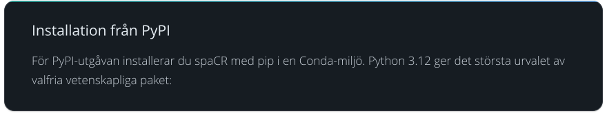

.. code-block:: bash

   conda create -n spacr python=3.12 -y
   conda activate spacr
   python -m pip install --upgrade pip
   python -m pip install spacr
   spacr

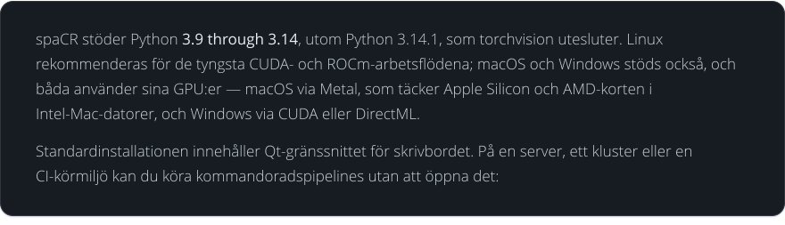dspipelines utan att öppna det:
   :width: 99.5%

.. code-block:: bash

   python -m pip install spacr
   spacr-run --list

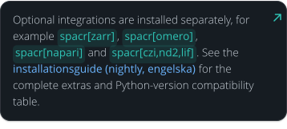

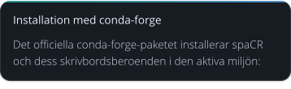

.. code-block:: bash

   conda create -n spacr python=3.12 -y
   conda activate spacr
   conda install conda-forge::spacr
   spacr

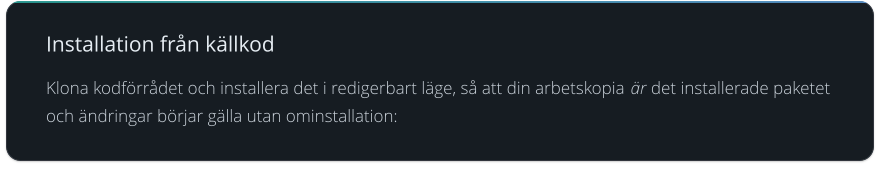

.. code-block:: bash

   git clone https://github.com/EinarOlafsson/spacr.git
   cd spacr
   conda create -n spacr python=3.12 -y
   conda activate spacr
   pip install -e .
   spacr

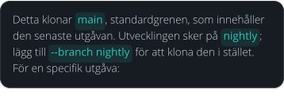

.. code-block:: bash

   git clone --branch v1.5.0.5 https://github.com/EinarOlafsson/spacr.git

.. code-block:: bash

   git pull
   pip install -e .

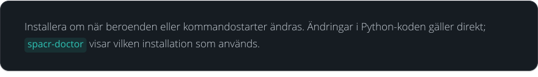

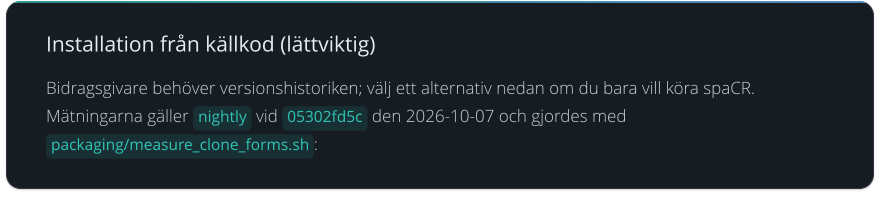

.. code-block:: bash

   # One commit instead of every version: 2048 MB downloaded, 140 s.
   # No history, so no git log, no git blame and no git bisect.
   # git pull still works, but stays shallow until git fetch --unshallow.
   git clone --depth 1 --branch nightly https://github.com/EinarOlafsson/spacr.git
   cd spacr && pip install -e .

   # Runtime files: 104 MB on disk, 6 s (Git: 38 MB; files: 66 MB).
   # No history, docs, tests, tools, features or example data.
   # --with-docs, --with-tests and --with-translations put those back;
   # --dir, --branch, --no-install and --help do the obvious things.
   # packaging/source_install_excludes.txt lists every skipped path.
   curl -fsSL https://raw.githubusercontent.com/EinarOlafsson/spacr/nightly/packaging/install_from_source.sh -o install_spacr.sh
   sh install_spacr.sh --branch nightly

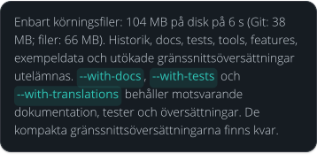ns storlek och tid varierar med grenen.
   :width: 99.5%

.. code-block:: bash

   spacr                                      # launch the Qt application
   spacr-doctor                               # diagnose the installation
   spacr-run --list                           # list headless modules
   spacr-run --describe MODULE                # inspect a module contract
   spacr-run MODULE --settings settings.csv   # execute a module
   spacr-run validate --module MODULE \
       --settings settings.csv                # validate before running
   spacr-repro RUN_DIR                        # replay a recorded run
   spacr-download --list                      # what example data exists
   spacr-download measure annotate            # fetch example sets by name
   spacr-make-masks --folder DIR              # curate masks as a resumable queue
   spacr-make-masks --folder DIR --order easy --limit 50

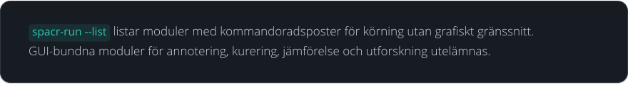

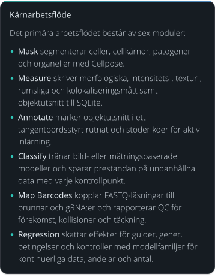och stöder köer för aktiv inlärning. Classify tränar bild- eller mätningsbaserade modeller och sparar prestandan på undanhållna data med varje kontrollpunkt. Map Barcodes kopplar FASTQ-läsningar till brunnar och gRNA:er och rapporterar QC för förekomst, kollisioner och täckning. Regression skattar effekter för guider, gener, betingelser och kontroller med modellfamiljer för kontinuerliga data, andelar och antal.
   :width: 99.5%

.. spacr-workflow-begin

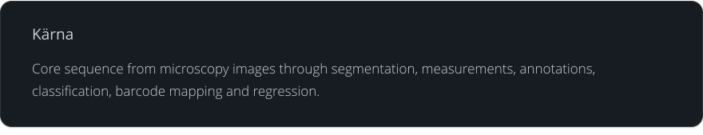

| |Module_mask|\ |Module_measure|\ |Module_annotate|\ |Module_classify_merged|\ |Module_map_barcodes|\ |Module_regression|

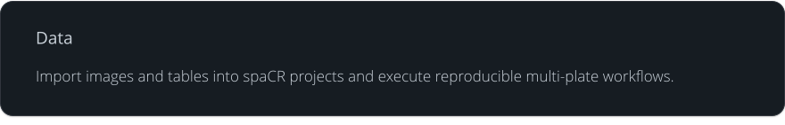

| |Module_foreign|\ |Module_embeddings|\ |Module_run_compare|\ |Module_experiment_design|\ |Module_power|\ |Module_dose_response|
| |Module_qc_dashboard|

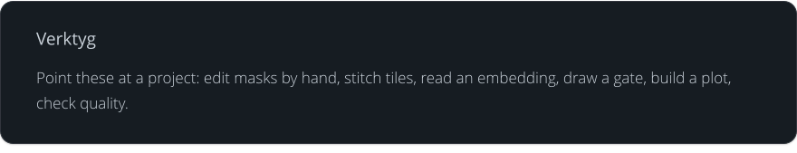

| |Module_make_masks|\ |Module_align|\ |Module_umap|\ |Module_gate_editor|\ |Module_graph_builder|

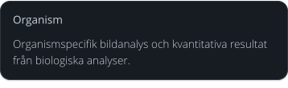

| |Module_toxoplasma|

.. |Module_mask| raw:: html

   

.. |Module_measure| raw:: html

   

.. |Module_annotate| raw:: html

   

.. |Module_classify_merged| raw:: html

   

.. |Module_map_barcodes| raw:: html

   

.. |Module_regression| raw:: html

   

.. |Module_foreign| raw:: html

   

.. |Module_embeddings| raw:: html

   

.. |Module_run_compare| raw:: html

   

.. |Module_experiment_design| raw:: html

   

.. |Module_power| raw:: html

   

.. |Module_dose_response| raw:: html

   

.. |Module_qc_dashboard| raw:: html

   

.. |Module_make_masks| raw:: html

   

.. |Module_align| raw:: html

   

.. |Module_umap| raw:: html

   

.. |Module_gate_editor| raw:: html

   

.. |Module_graph_builder| raw:: html

   

.. |Module_toxoplasma| raw:: html

   

.. spacr-workflow-end

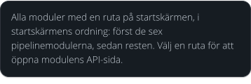

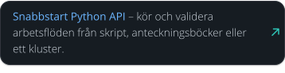

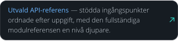

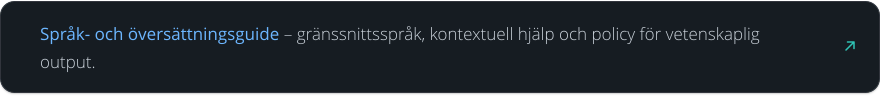

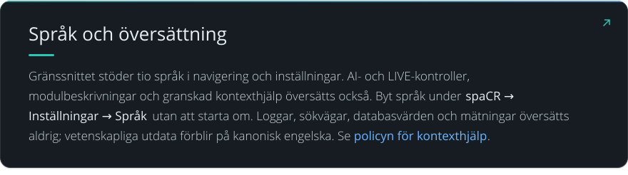, databasvärden och mätningar översätts aldrig; vetenskapliga utdata förblir på kanonisk engelska. Se policyn för kontexthjälp.
   :width: 99.5%
   :target: ../../source/localization.rst#contextual-help

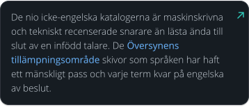

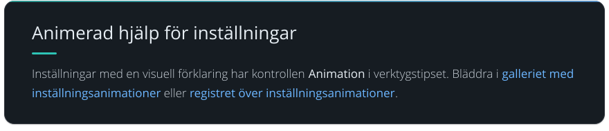

| |animated-setting-guidance-link-1|\ |animated-setting-guidance-link-2|

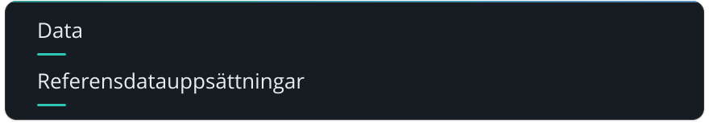

|DataBioStudies| |DataHuggingFace| |DataNCBI| |DataSpaCRPower| |DataBioRxiv|

.. |DataBioStudies| image:: ../../../spacr/resources/icons/databanks/biostudies_button.png
   :width: 72
   :alt: Öppna mikroskopidatamängden i BioStudies
   :target: https://doi.org/10.6019/S-BIAD2135

.. |DataHuggingFace| image:: ../../../spacr/resources/icons/databanks/huggingface_button.png
   :width: 72
   :alt: Öppna testdatamängden på Hugging Face
   :target: https://huggingface.co/datasets/einarolafsson/toxo_mito

.. |DataNCBI| image:: ../../../spacr/resources/icons/databanks/ncbi_button.png
   :width: 72
   :alt: Öppna sekvenseringsdatamängden hos NCBI
   :target: https://www.ncbi.nlm.nih.gov/bioproject/?term=PRJNA1261935

.. |DataSpaCRPower| image:: ../../../spacr/resources/icons/databanks/spacrpower_button.png
   :width: 72
   :alt: Öppna spaCRPower
   :target: https://github.com/maomlab/spaCRPower

.. |DataBioRxiv| image:: ../../../spacr/resources/icons/databanks/biorxiv_button.png
   :width: 72
   :alt: Öppna bioRxiv-förhandsversionen
   :target: https://www.biorxiv.org/content/10.64898/2026.07.08.737057v1

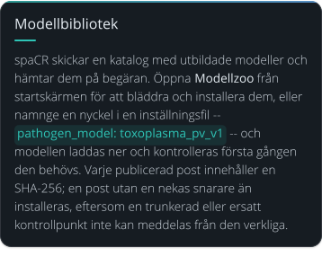erkliga.
   :width: 99.5%

.. spacr-model-zoo-begin

| |zoo_heading|
| |zoo_card_toxoplasma_pv_v4|\ |zoo_card_toxoplasma_plaque_v4|
| |zoo_card_toxoplasma_well_detector_v3|\ |zoo_card_toxoplasma_from_cellmask_v1|
| |zoo_card_live_cell_v1|\ |zoo_card_nuclei_from_cellmask_v1|
| |zoo_card_cell_from_hoechst_v1|\ |zoo_card_toxoplasma_from_hoechst_v1|

.. |zoo_heading| image:: ../../models/cards/heading.svg
   :alt: Default models · held-out scores
   :target: ../../models/README.md
   :width: 99.5%

.. |zoo_card_toxoplasma_pv_v4| image:: ../../models/cards/toxoplasma_pv_v4.svg
   :alt: Score card of Parasite vacuoles v4 (toxoplasma_pv_v4, default): F1 0.854 on 11 held-out wells against 0.765 for stock cpsam_v2. F1 0.854 against stock cpsam_v2's 0.765 on the 11 anchor wells at IoU 0.5; AJI 0.776 against 0.505.
   :target: ../../models/toxoplasma_pv_v4.md
   :width: 49.5%

.. |zoo_card_toxoplasma_plaque_v4| image:: ../../models/cards/toxoplasma_plaque_v4.svg
   :alt: Score card of Plaques v4 (toxoplasma_plaque_v4, default): F1 0.815 on 263 held-out fields against 0.373 for stock cpsam_v2. F1 0.815 (toxoplasma_plaque_v3 0.844) on the 263 held-out fields at IoU 0.5; stock cpsam_v2 0.373 there with the Cellpose evaluation scorer.
   :target: ../../models/toxoplasma_plaque_v4.md
   :width: 49.5%

.. |zoo_card_toxoplasma_well_detector_v3| image:: ../../models/cards/toxoplasma_well_detector_v3.svg
   :alt: Score card of Plaque wells v3 (toxoplasma_well_detector_v3, default): mAP50 0.994 on 73 held-out images. Stock was not evaluated in this run; see the named incumbent comparison on the model card.
   :target: ../../models/toxoplasma_well_detector_v3.md
   :width: 49.5%

.. |zoo_card_toxoplasma_from_cellmask_v1| image:: ../../models/cards/toxoplasma_from_cellmask_v1.svg
   :alt: Score card of Vacuoles from cell mask v1 (toxoplasma_from_cellmask_v1, default): F1 0.606 on 463 held-out fields against 0.021 for stock cpsam_v2. F1 0.606 against 0.021 for stock cpsam_v2 on 463 well-grouped held-out fields, at IoU 0.5.
   :target: ../../models/toxoplasma_from_cellmask_v1.md
   :width: 49.5%

.. |zoo_card_live_cell_v1| image:: ../../models/cards/live_cell_v1.svg
   :alt: Score card of Live cells v1 (live_cell_v1, default): F1 0.694 on 2,199 held-out fields against 0.738 for stock cpsam_v2. On the datasets stock cpsam_v2 never trained on, F1 0.960 against 0.885 at IoU 0.5; over all 2,199 test fields, 0.694 against 0.738, because stock trained on LIVECell and YeaZ and wins on LIVECell.
   :target: ../../models/live_cell_v1.md
   :width: 49.5%

.. |zoo_card_nuclei_from_cellmask_v1| image:: ../../models/cards/nuclei_from_cellmask_v1.svg
   :alt: Score card of Nuclei from cell mask v1 (nuclei_from_cellmask_v1, default): F1 0.888 on 453 held-out fields against 0.201 for stock cpsam_v2. F1 0.888 against 0.201 for stock cpsam_v2 on 453 well-grouped held-out fields, at IoU 0.5.
   :target: ../../models/nuclei_from_cellmask_v1.md
   :width: 49.5%

.. |zoo_card_cell_from_hoechst_v1| image:: ../../models/cards/cell_from_hoechst_v1.svg
   :alt: Score card of Cells from Hoechst v1 (cell_from_hoechst_v1, default): F1 0.870 on 451 held-out fields against 0.301 for stock cpsam_v2. F1 0.870 against stock cpsam_v2's 0.301 on 451 held-out fields at IoU 0.5 -- a delta of 0.569.
   :target: ../../models/cell_from_hoechst_v1.md
   :width: 49.5%

.. |zoo_card_toxoplasma_from_hoechst_v1| image:: ../../models/cards/toxoplasma_from_hoechst_v1.svg
   :alt: Score card of Vacuoles from Hoechst v1 (toxoplasma_from_hoechst_v1, default): F1 0.569 on 463 held-out fields against 0.002 for stock cpsam_v2. F1 0.569 against 0.002 for stock cpsam_v2 on 463 well-grouped held-out fields, at IoU 0.5.
   :target: ../../models/toxoplasma_from_hoechst_v1.md
   :width: 49.5%

| |generated-model-zoo-1-link-1|\ |generated-model-zoo-1-link-2|\ |generated-model-zoo-1-link-3|
| |generated-model-zoo-1-link-4|\ |generated-model-zoo-1-link-5|\ |generated-model-zoo-1-link-6|
| |generated-model-zoo-1-link-7|

.. |generated-model-zoo-1-link-7| image:: ../../readme_images/sv/generated-model-zoo-1-link-7.svg
   :alt: toxoplasma_well_detector_v1
   :width: 32.8%
   :target: ../../models/toxoplasma_well_detector_v1.md

| |generated-model-zoo-2-link-1|\ |generated-model-zoo-2-link-2|

.. spacr-model-zoo-end

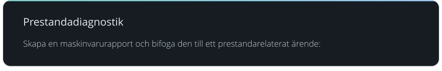

.. code-block:: bash

   python tools/spacr_hardware_report.py

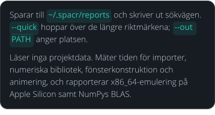lering på Apple Silicon samt NumPys BLAS.
   :width: 99.5%

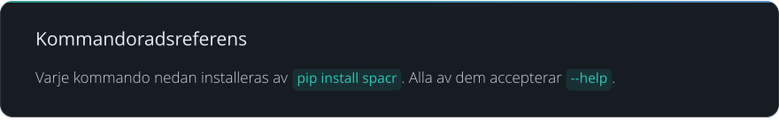

.. code-block:: bash

   spacr              # the desktop application
   spacr-tutorial     # the interactive tutorial library
   spacr-server       # no first-run setup screen, for unattended launches

.. code-block:: bash

   spacr-doctor       # diagnose the installation and say how to fix it
   safespacr          # the least spaCR that can still change a setting

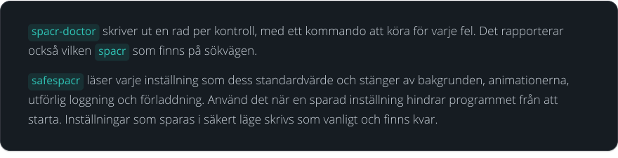ng och förladdning. Använd det när en sparad inställning hindrar programmet från att starta. Inställningar som sparas i säkert läge skrivs som vanligt och finns kvar.
   :width: 99.5%

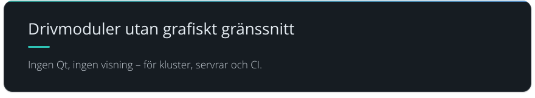

.. code-block:: bash

   spacr-run --list                              # modules with a headless entry
   spacr-run --describe MODULE                   # what a module consumes and produces
   spacr-run validate --module MODULE \
       --settings settings.csv                   # check settings before spending the run
   spacr-run MODULE --settings settings.csv      # execute
   spacr-remote --help                           # submit and monitor SSH, Slurm or cloud jobs

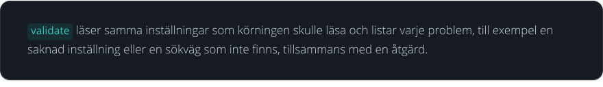

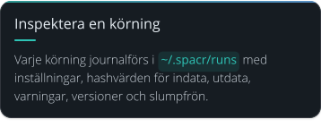

.. code-block:: bash

   spacr-repro RUN_DIR        # replay a recorded run from its journal
   spacr-workspace RUN_DIR    # what that run had open: databases, montages, views

.. code-block:: bash

   spacr-db-audit DB      # SQLite health, integrity, locking, reader/writer probe
   spacr-leakage          # classifier train/test leakage audit
   spacr-plugins          # installed plugin registry and failure diagnostics

.. code-block:: bash

   SPACR_LOG_LEVEL=DEBUG spacr      # verbose logging for one launch

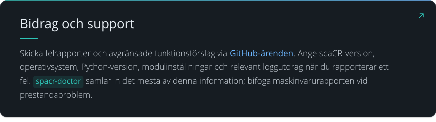a information; bifoga maskinvarurapporten vid prestandaproblem.
   :width: 99.5%
   :target: https://github.com/EinarOlafsson/spacr/issues

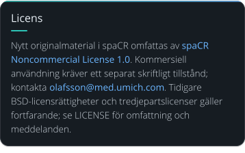

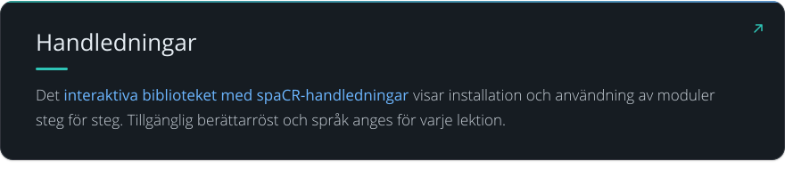

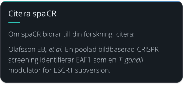

| |citing-spacr-2-1|\ |citing-spacr-2-2|

.. spacr-citing-papers-begin

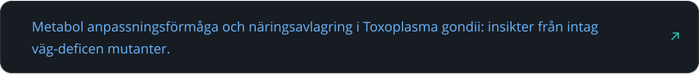

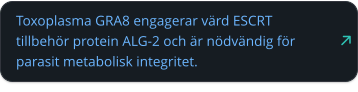

.. spacr-citing-papers-end

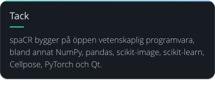ttskatalogerna.
   :width: 99.5%
   :target: ../TRANSLATION_MODELS.md
