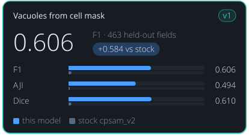

<!-- Generated by tools/build_model_cards.py from spacr/model_zoo.py; edit the zoo record, not this file. -->

# Vacuoles from cell mask

v1

**0.606** — F1 · 463 held-out fields

+0.584 vs stock cpsam_v2

| Metric | this model | stock cpsam_v2 |
| --- | --- | --- |
| F1 | 0.606 | 0.021 |
| AJI | 0.494 | 0.008 |
| Dice | 0.610 | 0.020 |

## Toxoplasma from Cell Mask (cross-channel)

`toxoplasma_from_cellmask_v1` · Cellpose-SAM (cpsam_v2) · default in the `toxoplasma_from_cellmask` family

Toxoplasma vacuoles from a whole-cell stain alone. Frees the parasite channel: stock Cellpose-SAM cannot predict one object type from another stain.

## Training data

Toxoplasma PV masks predicted from the HOST CELL MASK channel alone; 2567 training and 463 held-out fields, split by well, hosts HFF/HeLa/THP1.

cross-channel: given the host cell image, predicts where the Toxoplasma parasitophorous vacuoles are, with no parasite stain. 100 epochs, base cpsam_v2, AdamW lr 1e-5, targets are PV-regenerated masks.

## Hold-out performance

F1 0.606 against 0.021 for stock cpsam_v2 on 463 well-grouped held-out fields, at IoU 0.5.

Scorecard state: **recorded at publication**. These numbers were recorded with the model when it was published; a reviewed held-out comparison against the stock model is not yet available.

| Recorded | Value |
| --- | --- |
| Training set | 2567 |
| Test set | 463 |
| Test objects | 6116 |
| Cross-validation | no |
| F1 | 0.6058 |
| AJI | 0.4939 |
| Dice | 0.6096 |
| Stock F1 | 0.0215 |
| Stock AJI | 0.0080 |
| Stock Dice | 0.0201 |
| Training loss | 0.0075 |
| Validation loss | 0.0100 |
| Best epoch | 100 / 100 |

## Fields this model never saw (curated ground truth)

Re-scored 2026-11-10 against hand-curated masks on fields this model never saw, beside stock cpsam_v2 (the control) on the identical fields. Receipt: `features/data/model_rescore_unseen_20261110/receipt.json`.

| Metric | This model (95% CI) | Stock cpsam_v2 (95% CI) | Difference (95% CI) |
| --- | --- | --- | --- |
| Object F1 | 0.355 (0.300 to 0.411) | 0.012 (0.009 to 0.016) | 0.342 (0.287 to 0.399) |
| Boundary F1 (2 px) | 0.298 (0.251 to 0.345) | 0.023 (0.017 to 0.029) | 0.275 (0.229 to 0.321) |
| Precision | 0.683 (0.616 to 0.743) | 0.007 (0.005 to 0.010) | 0.676 (0.610 to 0.737) |
| Recall | 0.239 (0.196 to 0.286) | 0.042 (0.031 to 0.054) | 0.197 (0.152 to 0.247) |
| AJI | 0.220 (0.178 to 0.264) | 0.008 (0.006 to 0.010) | 0.212 (0.170 to 0.257) |
| Dice | 0.387 (0.324 to 0.450) | 0.027 (0.019 to 0.036) | 0.360 (0.298 to 0.422) |

n = 80 fields (2 with no vacuole) and 1,332 curated objects. This model reported 467 objects: 319 matched, 148 false, 1,013 curated objects missed. Stock cpsam_v2 reported 7,665: 56 matched, 7,609 false, 1,276 missed. Confidence intervals: 2000 group-bootstrap resamples of 80 well groups (seed 20261110).

| Group | Fields | Objects | Object F1 | Precision | Recall | AJI | Objects reported | Stock cpsam_v2 object F1 |
| --- | --- | --- | --- | --- | --- | --- | --- | --- |
| acquisition `anuRep__Replication09182026-plate1` | 80 | 1,332 | 0.355 | 0.683 | 0.239 | 0.220 | 467 | 0.012 |
| curation source `pv_r7_dataset_recuration` | 60 | 928 | 0.377 | 0.701 | 0.258 | 0.215 | 341 | 0.012 |
| curation source `pv_r7_plate_test20` | 20 | 404 | 0.302 | 0.635 | 0.198 | 0.233 | 126 | 0.013 |

- Low recall: the model found 319 of 1,332 curated vacuoles and missed 1,013; what it does report is mostly right (precision 0.683).
- All 80 fields come from one acquisition (anuRep Replication09182026 plate 1), so this re-score says nothing about other hosts or stains.
- On these same 80 fields toxoplasma_from_hoechst_v1 scores object F1 0.551.
- Stock cpsam_v2 reports 7,665 objects and matches 56 vacuoles: it cannot do this task.

Fair comparison: Each model and stock cpsam_v2 are scored on the same fields and the same input pixels (SHA-256 per field), against the same curated masks, with the same scoring code and thresholds (IoU 0.5 matching, 2 px boundary tolerance), in the same environment (cellpose 4.2.1.1, the version the model was trained with).

## Notes

- F1 0.606, AJI 0.494, Dice 0.610 at IoU 0.5 against stock cpsam_v2's 0.021/0.008/0.020 -- stock cannot do this task at all.
- Per host: HeLa 0.711, HFF 0.557, THP1 0.465; THP1 is the weak case.
- The held-out split selects the checkpoint, so it is validation data rather than an independent test set.
- Accuracy falls above IoU 0.8 -- suited to counting, occupancy and area rather than precise morphometry.
- Re-scored 2026-11-10 on curated ground truth, fields this model never saw (spaCR pipeline call, defaults, cellpose 4.2.1.1; receipt features/data/model_rescore_unseen_20261110/receipt.json): object F1 0.355 (95% CI 0.300 to 0.411) against stock cpsam_v2's 0.012 on 80 fields with 1,332 curated vacuoles, at IoU 0.5. Precision is 0.683 but recall is 0.239: it misses about three of every four vacuoles. The recorded F1 0.606 was scored against automatic PV-regenerated masks on the checkpoint-selection split, so it overstates accuracy on curated masks. Default unchanged.

## How to read these scores

- **Precision** is the share of objects the model reported that match a reference object; low precision means false detections. **Recall** is the share of reference objects the model found; low recall means missed objects.
- **F1** is the harmonic mean of precision and recall, so it is high only when both are. Either alone can look near-perfect: a model that reports one obvious object has high precision, and one that reports every dark blob has high recall.
- **IoU** (intersection over union) is the overlap between a predicted and a reference object divided by the area the two cover together. A score given at IoU 0.5 counts an object as found when that ratio reaches 0.5.
- **AJI** (aggregated Jaccard index) adds up the overlap of every matched pair and divides it by their combined area plus the area of unmatched objects, so merged, split and missed objects all lower it.
- **Dice** is twice the overlap divided by the predicted area plus the reference area.
- **Stock** is the base model named under Architecture, run without fine-tuning on the same images. **Difference** is this model's score minus stock's.
- **Object F1** is F1 over whole objects matched at IoU 0.5. **Boundary F1 (2 px)** is F1 over outline pixels, where a predicted outline pixel counts when it lies within 2 pixels of a reference outline.
- A **95% CI** (confidence interval) is the range the pooled score falls in for 95% of bootstrap resamples, drawn by well so that neighbouring fields of one well stay together.
- A **hold-out** or **test** set is images kept out of training and used only for scoring. The re-score note says how many of its fields this model had not seen.

## Files

- Hugging Face: [einarolafsson/toxoplasma-from-cellmask-cpsam](https://huggingface.co/einarolafsson/toxoplasma-from-cellmask-cpsam)
- File name in spaCR: `toxoplasma_from_cellmask_pv`
- SHA-256: `481dfccc1a68cc594aafcb71088efc25b5f5c6a6240e52902c0089759b3149ab`
- Trained by: einarolafsson

Models are hosted on each author's own Hugging Face account. spaCR downloads this one from there the first time it is needed and checks it against the SHA-256 above. `spacr.model_zoo.publish_model` uploads a model and returns the catalogue row to add.

[All model cards](README.md) · [All scorecards as CSV](scorecards.csv)
