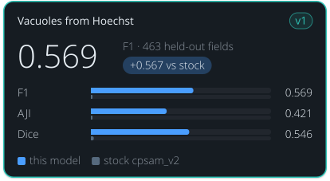

<!-- Generated by tools/build_model_cards.py from spacr/model_zoo.py; edit the zoo record, not this file. -->

# Vacuoles from Hoechst

v1

**0.569** — F1 · 463 held-out fields

+0.567 vs stock cpsam_v2

| Metric | this model | stock cpsam_v2 |
| --- | --- | --- |
| F1 | 0.569 | 0.002 |
| AJI | 0.421 | 0.006 |
| Dice | 0.546 | 0.016 |

## Toxoplasma from Hoechst (cross-channel)

`toxoplasma_from_hoechst_v1` · Cellpose-SAM (cpsam_v2) · default in the `toxoplasma_from_hoechst` family

Toxoplasma vacuoles from a Hoechst (nuclear) stain alone. Frees the parasite channel: stock Cellpose-SAM cannot predict one object type from another stain.

## Training data

Toxoplasma PV masks predicted from the HOECHST channel alone; 2567 training and 463 held-out fields, split by well, hosts HFF/HeLa/THP1.

cross-channel: given the Hoechst/nuclear image, predicts where the Toxoplasma parasitophorous vacuoles are, with no parasite stain. 100 epochs, base cpsam_v2, AdamW lr 1e-05, targets are PV-regenerated masks.

## Hold-out performance

F1 0.569 against 0.002 for stock cpsam_v2 on 463 well-grouped held-out fields, at IoU 0.5.

Scorecard state: **recorded at publication**. These numbers were recorded with the model when it was published; a reviewed held-out comparison against the stock model is not yet available.

| Recorded | Value |
| --- | --- |
| Training set | 2567 |
| Test set | 463 |
| Cross-validation | no |
| F1 | 0.569 |
| AJI | 0.421 |
| Dice | 0.546 |
| Stock F1 | 0.002 |
| Stock AJI | 0.006 |
| Stock Dice | 0.016 |

## Fields this model never saw (curated ground truth)

Re-scored 2026-11-10 against hand-curated masks on fields this model never saw, beside stock cpsam_v2 (the control) on the identical fields. Receipt: `features/data/model_rescore_unseen_20261110/receipt.json`.

| Metric | This model (95% CI) | Stock cpsam_v2 (95% CI) | Difference (95% CI) |
| --- | --- | --- | --- |
| Object F1 | 0.446 (0.404 to 0.486) | 0.001 (0.001 to 0.002) | 0.445 (0.403 to 0.484) |
| Boundary F1 (2 px) | 0.428 (0.391 to 0.462) | 0.037 (0.032 to 0.042) | 0.391 (0.356 to 0.423) |
| Precision | 0.441 (0.366 to 0.525) | 0.001 (0.001 to 0.001) | 0.440 (0.365 to 0.524) |
| Recall | 0.452 (0.432 to 0.474) | 0.003 (0.002 to 0.004) | 0.449 (0.429 to 0.471) |
| AJI | 0.384 (0.357 to 0.412) | 0.011 (0.009 to 0.012) | 0.373 (0.347 to 0.401) |
| Dice | 0.606 (0.571 to 0.640) | 0.029 (0.025 to 0.033) | 0.577 (0.544 to 0.609) |

n = 224 fields (11 with no vacuole) and 13,474 curated objects. This model reported 13,789 objects: 6,085 matched, 7,704 false, 7,389 curated objects missed. Stock cpsam_v2 reported 35,658: 34 matched, 35,624 false, 13,440 missed. Confidence intervals: 2000 group-bootstrap resamples of 221 well groups (seed 20261110).

| Group | Fields | Objects | Object F1 | Precision | Recall | AJI | Objects reported | Stock cpsam_v2 object F1 |
| --- | --- | --- | --- | --- | --- | --- | --- | --- |
| acquisition `RH__abTg__HELAtubulin_20230923_114209` | 29 | 67 | 0.141 | 0.078 | 0.731 | 0.202 | 629 | 0.001 |
| acquisition `RH__abTg__HFFtubulin_20230922_175830` | 38 | 140 | 0.039 | 0.020 | 0.807 | 0.081 | 5,606 | 0.000 |
| acquisition `RH__abTg__TSG101RH111523_20231115_162716` | 43 | 4,887 | 0.581 | 0.805 | 0.454 | 0.454 | 2,760 | 0.002 |
| acquisition `anuRep__Replication09182026-plate1` | 80 | 1,332 | 0.551 | 0.555 | 0.546 | 0.519 | 1,309 | 0.002 |
| acquisition `me49__abTg__Anu_ME49ALIX_final_plate1_20230822_192029` | 34 | 7,048 | 0.565 | 0.854 | 0.422 | 0.424 | 3,485 | 0.001 |
| curation source `pv_r7_dataset_recuration` | 102 | 6,741 | 0.569 | 0.705 | 0.476 | 0.461 | 4,553 | 0.001 |
| curation source `pv_r7_plate_test20` | 20 | 404 | 0.496 | 0.563 | 0.443 | 0.543 | 318 | 0.005 |
| curation source `pv_round3_queue` | 102 | 6,329 | 0.354 | 0.302 | 0.426 | 0.292 | 8,918 | 0.001 |

- Recall is 0.452: the model found 6,085 of 13,474 curated vacuoles and missed 7,389.
- The HFF and HeLa tubulin acquisitions fail: 5,606 objects reported for 140 curated vacuoles on HFF (precision 0.020, F1 0.039) and 629 for 67 on HeLa (precision 0.078, F1 0.141); do not use this model on those plates without checking the masks.
- The other three acquisitions score object F1 0.551 to 0.581.
- On the 80 anuRep plate 1 fields that toxoplasma_from_cellmask_v1 was also scored on, this model scores object F1 0.551 against its 0.355, so the recorded ranking of the two routes does not hold on curated masks there.
- 95% CIs are given for the pooled numbers only; per-group rows have none.

Fair comparison: Each model and stock cpsam_v2 are scored on the same fields and the same input pixels (SHA-256 per field), against the same curated masks, with the same scoring code and thresholds (IoU 0.5 matching, 2 px boundary tolerance), in the same environment (cellpose 4.2.1.1, the version the model was trained with).

## Notes

- F1 0.569, AJI 0.421, Dice 0.546 at IoU 0.5 against stock cpsam_v2's 0.002/0.006/0.016.
- The Hoechst route is harder than the cell-mask route -- compare toxoplasma_from_cellmask_v1.
- The held-out split selects the checkpoint, so it is validation data rather than an independent test set.
- Accuracy falls above IoU 0.8 -- suited to counting, occupancy and area rather than precise morphometry.
- Re-scored 2026-11-10 on curated ground truth, fields this model never saw (spaCR pipeline call, defaults, cellpose 4.2.1.1; receipt features/data/model_rescore_unseen_20261110/receipt.json): object F1 0.446 (95% CI 0.404 to 0.486) against stock cpsam_v2's 0.001 on 224 fields with 13,474 curated vacuoles, at IoU 0.5. Per acquisition F1 ranges from 0.039 to 0.581; on the HFF and HeLa tubulin acquisitions precision is 0.020 and 0.078, so most objects it reports there are not vacuoles. The recorded F1 0.569 was scored against automatic PV-regenerated masks on the checkpoint-selection split. Default unchanged.

## How to read these scores

- **Precision** is the share of objects the model reported that match a reference object; low precision means false detections. **Recall** is the share of reference objects the model found; low recall means missed objects.
- **F1** is the harmonic mean of precision and recall, so it is high only when both are. Either alone can look near-perfect: a model that reports one obvious object has high precision, and one that reports every dark blob has high recall.
- **IoU** (intersection over union) is the overlap between a predicted and a reference object divided by the area the two cover together. A score given at IoU 0.5 counts an object as found when that ratio reaches 0.5.
- **AJI** (aggregated Jaccard index) adds up the overlap of every matched pair and divides it by their combined area plus the area of unmatched objects, so merged, split and missed objects all lower it.
- **Dice** is twice the overlap divided by the predicted area plus the reference area.
- **Stock** is the base model named under Architecture, run without fine-tuning on the same images. **Difference** is this model's score minus stock's.
- **Object F1** is F1 over whole objects matched at IoU 0.5. **Boundary F1 (2 px)** is F1 over outline pixels, where a predicted outline pixel counts when it lies within 2 pixels of a reference outline.
- A **95% CI** (confidence interval) is the range the pooled score falls in for 95% of bootstrap resamples, drawn by well so that neighbouring fields of one well stay together.
- A **hold-out** or **test** set is images kept out of training and used only for scoring. The re-score note says how many of its fields this model had not seen.

## Files

- Hugging Face: [einarolafsson/toxoplasma-from-hoechst-cpsam](https://huggingface.co/einarolafsson/toxoplasma-from-hoechst-cpsam)
- File name in spaCR: `toxoplasma_from_hoechst_pv`
- SHA-256: `8dc05ebced3550d1a418c13d24d319e0482c742988df29a525520026cb2f0d96`
- Trained by: einarolafsson

Models are hosted on each author's own Hugging Face account. spaCR downloads this one from there the first time it is needed and checks it against the SHA-256 above. `spacr.model_zoo.publish_model` uploads a model and returns the catalogue row to add.

[All model cards](README.md) · [All scorecards as CSV](scorecards.csv)
