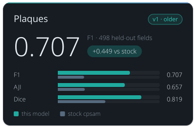

<!-- Generated by tools/build_model_cards.py from spacr/model_zoo.py; edit the zoo record, not this file. -->

# Plaques

v1 · older

**0.707** — F1 · 498 held-out fields

+0.449 vs stock cpsam

| Metric | this model | stock cpsam |
| --- | --- | --- |
| F1 | 0.707 | 0.258 |
| AJI | 0.657 | 0.265 |
| Dice | 0.819 | 0.467 |

## Toxoplasma Plaque v1

`toxoplasma_plaque_v1` · Cellpose-SAM (cpsam) · older version in the `toxoplasma_plaque` family

Toxoplasma plaques in crystal-violet plaque-assay wells. Stock Cellpose-SAM was never trained on plaques and finds few of them, fewest on Gel Doc scans.

The family's default is [toxoplasma_plaque_v4](toxoplasma_plaque_v4.md).

Other versions: [toxoplasma_plaque_v4](toxoplasma_plaque_v4.md), [toxoplasma_plaque_v3](toxoplasma_plaque_v3.md) (alternative), [toxoplasma_plaque_v2](toxoplasma_plaque_v2.md).

## Training data

Crystal violet plaque wells; 184 wells from 3 datasets, 95 in-house and 89 literature.

Toxoplasma gondii plaque assays; round 3, evaluated in-domain (NAS) and against a literature generalisation set.

## Hold-out performance

F1 0.707 against stock cpsam's 0.258 on the 498 strict hold-out fields at IoU 0.5; AJI 0.657 against 0.265.

| Metric | This model | Stock | Difference |
| --- | --- | --- | --- |
| F1 | 0.7074 | 0.2581 | 0.4493 |
| Precision | 0.8298 | 0.2050 | 0.6248 |
| Recall | 0.6165 | 0.3484 | 0.2680 |
| AJI | 0.6572 | 0.2649 | 0.3923 |
| Dice | 0.8191 | 0.4667 | 0.3524 |

Evaluation set `gt_rescore_20261011`, version `strict hold-out, pooled`; 498 scored fields and 19993 annotated objects.

| Recorded | Value |
| --- | --- |
| Training set | 184 wells |
| Test set | 498 fields |
| Test objects | 19,993 |
| Cross-validation | 3-fold |

## Notes

- F1 0.856 in-domain and 0.806 on the literature set (3-fold cross-validated, SD 0.020), against 0.718 for round 1.
- Round 3 trades precision (0.939 down to 0.858) for recall (0.631 up to 0.811) on the literature set, which is the right direction for a counting assay.
- PREFER THIS ONE FOR MICROSCOPE-ONLY WORK. On the round-5 test split it scores 0.836 on PFA-fixed wells against round 5's 0.808, at precision 0.93 against 0.81. For mixed sources, or any phone-camera image, use toxoplasma_plaque_v2, which round 3 cannot handle at all (0.249 there).
- Re-scored 2026-10-11 on curated ground truth (spaCR pipeline call, defaults; receipt features/data/model_rescore_curated_gt_2026-10-11/receipt.json): strict hold-out, fields this model never saw, F1 0.707 at IoU 0.5 on n = 498 of 562 fields (n differs between models); common subset unseen by every plaque model, n = 114, F1 0.402 (95% bootstrap CI 0.300 to 0.504). Without the v3-seeded Gel Doc truth (n = 81): F1 0.472. Earlier numbers in this row are superseded by this re-score where they differ. 263-field set seen counts: v1 54, v2 178, v3 137, v4 0; GRA8 Plate1 (hold-out of v3) is the same physical plate as ReimagedPlate1 (training data of v4). Default unchanged.

## How to read these scores

- **Precision** is the share of objects the model reported that match a reference object; low precision means false detections. **Recall** is the share of reference objects the model found; low recall means missed objects.
- **F1** is the harmonic mean of precision and recall, so it is high only when both are. Either alone can look near-perfect: a model that reports one obvious object has high precision, and one that reports every dark blob has high recall.
- **IoU** (intersection over union) is the overlap between a predicted and a reference object divided by the area the two cover together. A score given at IoU 0.5 counts an object as found when that ratio reaches 0.5.
- **AJI** (aggregated Jaccard index) adds up the overlap of every matched pair and divides it by their combined area plus the area of unmatched objects, so merged, split and missed objects all lower it.
- **Dice** is twice the overlap divided by the predicted area plus the reference area.
- **Stock** is the base model named under Architecture, run without fine-tuning on the same images. **Difference** is this model's score minus stock's.
- **Cross-validated** scores split the data into folds, hold out each fold once and report the mean over folds with its standard deviation (**SD**, or +/-). A single split can mislead; the SD shows how far the score moves from one split to another.
- A **hold-out** or **test** set is images kept out of training and used only for scoring. The re-score note says how many of its fields this model had not seen.

## Files

- Hugging Face: [einarolafsson/toxoplasma-plaque-segmentation-cpsam](https://huggingface.co/einarolafsson/toxoplasma-plaque-segmentation-cpsam)
- File name in spaCR: `cpsam_plaque_r3`
- SHA-256: `eeecd2d6cd5cbb4dddee71564d5f460d26bb07ac125e0b494b7502fea4292d5d`
- Trained by: einarolafsson

Models are hosted on each author's own Hugging Face account. spaCR downloads this one from there the first time it is needed and checks it against the SHA-256 above. `spacr.model_zoo.publish_model` uploads a model and returns the catalogue row to add.

[All model cards](README.md)
