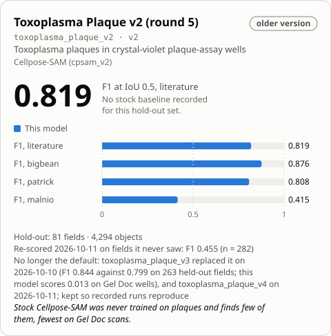

<!-- Generated by tools/build_model_cards.py from spacr/model_zoo.py; edit the zoo record, not this file. -->

# Toxoplasma Plaque v2 (round 5)

`toxoplasma_plaque_v2` · Cellpose-SAM (cpsam_v2) · older version in the `toxoplasma_plaque` family

The family's default is [toxoplasma_plaque_v4](toxoplasma_plaque_v4.md).

Other versions: [toxoplasma_plaque_v4](toxoplasma_plaque_v4.md), [toxoplasma_plaque_v3](toxoplasma_plaque_v3.md) (alternative), [toxoplasma_plaque_v1](toxoplasma_plaque_v1.md).

## Training data

488 curated fields across four domains -- 298 wells cropped from published figures, 96 phone-camera wells, 67 PFA and 27 methanol-fixed whole-well microscope scans; 27,582 plaques.

Toxoplasma plaque assays stained with crystal violet, from three microscopes and from published figures. Round 5: 332 training fields grouped by figure and by plate so none straddles the split, 100 epochs, base cpsam_v2, empty wells kept as negatives.

## Hold-out performance

Not scored against stock; on 81 held-out fields it ties round 3 on literature (0.819 vs 0.820) and beats it by 0.166 on phone-camera wells (0.415 vs 0.249).

| Recorded | Value |
| --- | --- |
| Training set | 332 fields, 4 domains |
| Training objects | 18532 |
| Test set | 81 fields |
| Test objects | 4294 |
| Cross-validation | no (grouped train/valid/test) |
| F1 | 0.819 literature / 0.876 bigbean / 0.808 patrick / 0.415 malnio |
| Stock F1 | not measured; scored against round 3 (0.820 literature) and round 4 (0.819) |
| Training loss | 0.1822 |
| Validation loss | 0.2069 |
| Best epoch | 100 / 100 |

## Notes

- No longer the default: toxoplasma_plaque_v3 replaced it on 2026-10-10 (F1 0.844 against 0.799 on 263 held-out fields; this model scores 0.013 on Gel Doc wells), and toxoplasma_plaque_v4 on 2026-10-11; kept so recorded runs reproduce.
- COMPLEMENTS toxoplasma_plaque_v1 rather than replacing it: prefer v1 (round 3) for microscope-only work, where it scores 0.836 against this model's 0.808 on PFA-fixed wells and is far more precise; prefer this one for mixed or unknown sources.
- The only plaque model trained on phone-camera wells -- F1 0.415 against round 3's 0.249, though recall there is 0.296, so it still misses most plaques on phone images and is not yet a counting tool.
- It did NOT clear the promotion bar of 0.02 literature F1 fixed before the run (it came in at -0.001), so round 3 remains production.
- Balanced precision/recall (0.81/0.83) where round 3 is lopsided (0.93/0.73): round 3's low recall systematically UNDERCOUNTS, which matters more than F1 for a counting assay.
- Hallucinates 2 objects across 6 blank-lawn wells where round 3 hallucinates 19.
- First plaque model on cpsam_v2; rounds 1-4 used cpsam v1, so base and data changed together and the gap to round 3 is not attributable to the extra curation alone.
- Training data: https://huggingface.co/datasets/einarolafsson/toxoplasma-plaque-dataset.
- Re-scored 2026-10-11 on curated ground truth (spaCR pipeline call, defaults; receipt features/data/model_rescore_curated_gt_2026-10-11/receipt.json): strict hold-out, fields this model never saw, F1 0.455 at IoU 0.5 on n = 282 of 562 fields (n differs between models); common subset unseen by every plaque model, n = 114, F1 0.360 (95% bootstrap CI 0.249 to 0.472). Without the v3-seeded Gel Doc truth (n = 81): F1 0.406. Earlier numbers in this row are superseded by this re-score where they differ. 263-field set seen counts: v1 54, v2 178, v3 137, v4 0; GRA8 Plate1 (hold-out of v3) is the same physical plate as ReimagedPlate1 (training data of v4). Default unchanged.

## How to read these scores

- **Precision** is the share of objects the model reported that match a reference object; low precision means false detections. **Recall** is the share of reference objects the model found; low recall means missed objects.
- **F1** is the harmonic mean of precision and recall, so it is high only when both are. Either alone can look near-perfect: a model that reports one obvious object has high precision, and one that reports every dark blob has high recall.
- **IoU** (intersection over union) is the overlap between a predicted and a reference object divided by the area the two cover together. A score given at IoU 0.5 counts an object as found when that ratio reaches 0.5.
- **Stock** is the base model named under Architecture, run without fine-tuning on the same images. **Difference** is this model's score minus stock's.
- A **hold-out** or **test** set is images kept out of training and used only for scoring. The re-score note says how many of its fields this model had not seen.

## Files

- Hugging Face: [einarolafsson/toxoplasma-plaque-segmentation-cpsam-r5](https://huggingface.co/einarolafsson/toxoplasma-plaque-segmentation-cpsam-r5)
- File name in spaCR: `cpsam_plaque_r5`
- SHA-256: `0927023a745ac6a19bae0ec72c89b7b864a4ff8d047a41f3f1e9767e1a4d0600`
- Trained by: einarolafsson

Models are hosted on each author's own Hugging Face account. spaCR downloads this one from there the first time it is needed and checks it against the SHA-256 above. `spacr.model_zoo.publish_model` uploads a model and returns the catalogue row to add.

[All model cards](README.md)
