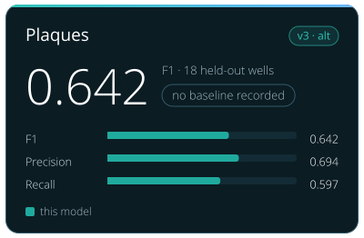

<!-- Generated by tools/build_model_cards.py from spacr/model_zoo.py; edit the zoo record, not this file. -->

# Plaques

v3 · alt

**0.732** — F1 · 232 held-out fields

+0.604 vs stock cpsam

| Metric | this model | stock cpsam |
| --- | --- | --- |
| F1 | 0.732 | 0.128 |
| AJI | 0.628 | 0.173 |
| Dice | 0.811 | 0.334 |

## Toxoplasma Plaque v3 (Gel Doc r5, alternative)

`toxoplasma_plaque_v3` · Cellpose-SAM (cpsam, Cellpose 4.0.9) · alternative in the `toxoplasma_plaque` family

Toxoplasma plaques in crystal-violet plaque-assay wells. Stock Cellpose-SAM was never trained on plaques and finds few of them, fewest on Gel Doc scans.

The family's default is [toxoplasma_plaque_v4](toxoplasma_plaque_v4.md).

Other versions: [toxoplasma_plaque_v4](toxoplasma_plaque_v4.md), [toxoplasma_plaque_v2](toxoplasma_plaque_v2.md), [toxoplasma_plaque_v1](toxoplasma_plaque_v1.md).

## Training data

496 curated plaque fields, including 34 reviewed empty negatives and 71 Gel Doc wells; 100 epochs; fixed physical-plate/source groups.

496 curated plaque fields, including 34 reviewed empty negatives and 71 Gel Doc wells; 100 epochs; fixed physical-plate/source groups.

## Hold-out performance

F1 0.732 against stock cpsam's 0.128 on the 232 strict hold-out fields at IoU 0.5; AJI 0.628 against 0.173.

| Metric | This model | Stock | Difference |
| --- | --- | --- | --- |
| F1 | 0.7322 | 0.1280 | 0.6042 |
| Boundary F1 (2 px) | 0.6211 | 0.2157 | 0.4054 |
| Precision | 0.6763 | 0.0827 | 0.5936 |
| Recall | 0.7981 | 0.2825 | 0.5156 |
| AJI | 0.6275 | 0.1729 | 0.4547 |
| Dice | 0.8105 | 0.3337 | 0.4768 |

Evaluation set `gt_rescore_20261011`, version `strict hold-out, pooled`; 232 scored fields and 8379 annotated objects.

| Recorded | Value |
| --- | --- |
| Training set | 496 fields; 34 reviewed empty |
| Training objects | 25794 |
| Test set | 232 fields |
| Test objects | 8379 |
| Cross-validation | no |
| Training loss | 0.18370248939254452 |
| Validation loss | see monitored NAS history; final epoch not measured |
| Best epoch | final checkpoint, 100 epochs; no best-epoch selection |

## Notes

- Alternative since 2026-10-11, when toxoplasma_plaque_v4 (base cpsam_v2) became the default by the maintainer's choice. This model scores higher: on 263 held-out fields F1 0.844 against v4 0.815, and 0.913 against 0.804 on Gel Doc wells, through spacr.plaque.segment_plaque_image. Kept so recorded runs reproduce.
- Default 2026-10-10 to 2026-10-11: F1 0.844 against toxoplasma_plaque_v2 0.799, and 0.913 against 0.013 on Gel Doc wells (features/data/model_compare_2026-10-10).
- Its own release gate on independent literature crops did not pass at the time (literature F1 about 0.54 for every model).
- Gel Doc score requires min_size=0; min_size=150 gives F1 0.1041.
- Stock not measured; comparison baseline is incumbent r3.
- Distinct from the cpsam_v2 round-5 model already registered as toxoplasma_plaque_v2.
- Re-scored 2026-10-11 on curated ground truth (spaCR pipeline call, defaults; receipt features/data/model_rescore_curated_gt_2026-10-11/receipt.json): strict hold-out, fields this model never saw, F1 0.732 at IoU 0.5 on n = 232 of 562 fields (n differs between models); common subset unseen by every plaque model, n = 114, F1 0.548 (95% bootstrap CI 0.449 to 0.645). Without the v3-seeded Gel Doc truth (n = 81): F1 0.444. Earlier numbers in this row are superseded by this re-score where they differ. 263-field set seen counts: v1 54, v2 178, v3 137, v4 0; GRA8 Plate1 (hold-out of v3) is the same physical plate as ReimagedPlate1 (training data of v4). Default unchanged.

## How to read these scores

- **Precision** is the share of objects the model reported that match a reference object; low precision means false detections. **Recall** is the share of reference objects the model found; low recall means missed objects.
- **F1** is the harmonic mean of precision and recall, so it is high only when both are. Either alone can look near-perfect: a model that reports one obvious object has high precision, and one that reports every dark blob has high recall.
- **IoU** (intersection over union) is the overlap between a predicted and a reference object divided by the area the two cover together. A score given at IoU 0.5 counts an object as found when that ratio reaches 0.5.
- **AJI** (aggregated Jaccard index) adds up the overlap of every matched pair and divides it by their combined area plus the area of unmatched objects, so merged, split and missed objects all lower it.
- **Dice** is twice the overlap divided by the predicted area plus the reference area.
- **Stock** is the base model named under Architecture, run without fine-tuning on the same images. **Difference** is this model's score minus stock's.
- A **hold-out** or **test** set is images kept out of training and used only for scoring. The re-score note says how many of its fields this model had not seen.

## Files

- Hugging Face: [einarolafsson/toxoplasma-plaque-segmentation-cpsam-r5-geldoc](https://huggingface.co/einarolafsson/toxoplasma-plaque-segmentation-cpsam-r5-geldoc)
- File name in spaCR: `cpsam_plaque_r5_geldoc`
- SHA-256: `8f59850dbe09c3a252728b0a7ca38ae5b52a28f2dbaa7a068174b4b7bfac768c`
- Trained by: einarolafsson

Models are hosted on each author's own Hugging Face account. spaCR downloads this one from there the first time it is needed and checks it against the SHA-256 above. `spacr.model_zoo.publish_model` uploads a model and returns the catalogue row to add.

[All model cards](README.md)
