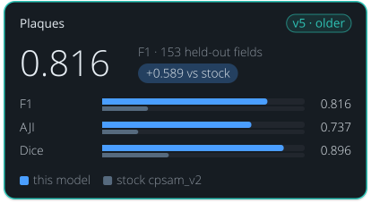

<!-- Generated by tools/build_model_cards.py from spacr/model_zoo.py; edit the zoo record, not this file. -->

# Plaques

v5

**0.816** — F1 · 153 held-out fields

+0.589 vs stock cpsam_v2

| Metric | this model | stock cpsam_v2 |
| --- | --- | --- |
| F1 | 0.816 | 0.227 |
| AJI | 0.737 | 0.178 |
| Dice | 0.896 | 0.329 |

## Toxoplasma Plaque v5 (round 7, cpsam_v2, default)

`toxoplasma_plaque_v5` · Cellpose-SAM (cpsam_v2, Cellpose 4.2.1.1) · default in the `toxoplasma_plaque` family

Toxoplasma plaques in crystal-violet plaque-assay wells. Stock Cellpose-SAM was never trained on plaques and finds few of them, fewest on Gel Doc scans.

Other versions: [toxoplasma_plaque_v4](toxoplasma_plaque_v4.md), [toxoplasma_plaque_v3](toxoplasma_plaque_v3.md) (alternative), [toxoplasma_plaque_v2](toxoplasma_plaque_v2.md), [toxoplasma_plaque_v1](toxoplasma_plaque_v1.md).

## Training data

1,507 curated plaque fields of 2026-10-15 (Gel Doc wells, lab plates, published figures, earlier curation rounds); 1,201 train / 153 validation / 153 test.

Toxoplasma plaques from Gel Doc wells, lab plates, published figures and earlier curation rounds (curated dataset of 2026-10-15); 100 epochs, final epoch kept, base cpsam_v2.

## Hold-out performance

F1 0.816 against stock cpsam_v2's 0.227 on the 153 strict hold-out fields at IoU 0.5; AJI 0.737 against 0.178.

Scorecard state: **reviewed hold-out scorecard**.

| Metric | This model | Stock | Difference |
| --- | --- | --- | --- |
| F1 | 0.8157 | 0.2268 | 0.5889 |
| Boundary F1 (2 px) | 0.7585 | 0.2883 | 0.4702 |
| Precision | 0.8674 | 0.1894 | 0.6779 |
| Recall | 0.7699 | 0.2824 | 0.4875 |
| AJI | 0.7366 | 0.1784 | 0.5582 |
| Dice | 0.8962 | 0.3291 | 0.5671 |

Evaluation set `plaque_curated_20261015_test`, version `strict hold-out, pooled`; 153 scored fields and 6540 annotated objects.

| Recorded | Value |
| --- | --- |
| Training set | 1201 fields + 153 validation |
| Training objects | 49360 |
| Test set | 153 fields |
| Test objects | 6540 |
| Cross-validation | no |
| Training loss | see training/run_config.json |
| Validation loss | see training/run_config.json |
| Best epoch | 100 / 100 (final epoch kept) |

## Notes

- The default plaque model since 2026-10-17, by the maintainer's choice; toxoplasma_plaque_v3 is the recommended alternative for Gel Doc wells and toxoplasma_plaque_v4 stays selectable.
- Scored 2026-10-17 on the 153 test fields of the curated 2026-10-15 dataset (spacr.plaque.segment_plaque_image, defaults): object F1 0.816 (95% bootstrap CI 0.778 to 0.848), v4 0.725, v3 0.741, stock cpsam_v2 0.227. On the 81 test fields neither v3 nor v4 saw: v5 0.803, v4 0.661, v3 0.684. AJI is level with v4 (0.737 against 0.744); Gel Doc wells 0.868 against v4 0.901 and v3 0.954.
- The final epoch 100 ships by the maintainer's rule: an earlier checkpoint replaces it only if better on every metric in every domain. Epoch 40 led on validation object F1 (0.766 against 0.750) but trailed on boundary F1 (0.700 against 0.711), AJI (0.661 against 0.667) and Dice (0.857 against 0.869); on test it scored F1 0.823.
- Training ran 100 epochs; indices 91 to 99 were resumed from epoch 90 after a power cut, with the same schedule and seeds (optimizer moments restarted at LR 2e-8).

## How to read these scores

- **Precision** is the share of objects the model reported that match a reference object; low precision means false detections. **Recall** is the share of reference objects the model found; low recall means missed objects.
- **F1** is the harmonic mean of precision and recall, so it is high only when both are. Either alone can look near-perfect: a model that reports one obvious object has high precision, and one that reports every dark blob has high recall.
- **IoU** (intersection over union) is the overlap between a predicted and a reference object divided by the area the two cover together. A score given at IoU 0.5 counts an object as found when that ratio reaches 0.5.
- **AJI** (aggregated Jaccard index) adds up the overlap of every matched pair and divides it by their combined area plus the area of unmatched objects, so merged, split and missed objects all lower it.
- **Dice** is twice the overlap divided by the predicted area plus the reference area.
- **Stock** is the base model named under Architecture, run without fine-tuning on the same images. **Difference** is this model's score minus stock's.
- A **hold-out** or **test** set is images kept out of training and used only for scoring.

## Files

- Hugging Face: [einarolafsson/toxoplasma-plaque-segmentation-cpsam-r7](https://huggingface.co/einarolafsson/toxoplasma-plaque-segmentation-cpsam-r7)
- File name in spaCR: `cpsam_plaque_r7`
- SHA-256: `9243917beefbc3d1c8d997d56c1980b811ffef9ee075dac60b099aec715fa8a1`
- Trained by: einarolafsson

Models are hosted on each author's own Hugging Face account. spaCR downloads this one from there the first time it is needed and checks it against the SHA-256 above. `spacr.model_zoo.publish_model` uploads a model and returns the catalogue row to add.

[All model cards](README.md) · [All scorecards as CSV](scorecards.csv)
