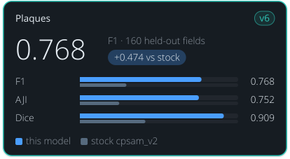

<!-- Generated by tools/build_model_cards.py from spacr/model_zoo.py; edit the zoo record, not this file. -->

# Plaques

v6

**0.768** — F1 · 160 held-out fields

+0.474 vs stock cpsam_v2

| Metric | this model | stock cpsam_v2 |
| --- | --- | --- |
| F1 | 0.768 | 0.294 |
| AJI | 0.752 | 0.249 |
| Dice | 0.909 | 0.414 |

## Toxoplasma Plaque v6 (round 8, cpsam_v2, resized wells, default)

`toxoplasma_plaque_v6` · Cellpose-SAM (cpsam_v2, Cellpose 4.2.1.1) · default in the `toxoplasma_plaque` family

Toxoplasma plaques in crystal-violet plaque-assay wells. Stock Cellpose-SAM was never trained on plaques and finds few of them, fewest on Gel Doc scans.

Other versions: [toxoplasma_plaque_v5](toxoplasma_plaque_v5.md), [toxoplasma_plaque_v4](toxoplasma_plaque_v4.md), [toxoplasma_plaque_v3](toxoplasma_plaque_v3.md) (alternative), [toxoplasma_plaque_v2](toxoplasma_plaque_v2.md), [toxoplasma_plaque_v1](toxoplasma_plaque_v1.md).

## Training data

1,520 curated plaque fields (Gel Doc wells, lab plates, published figures, earlier curation rounds); 1,196 train / 164 validation / 160 test, grouped per-domain split of 2026-10-24.

Toxoplasma plaques from Gel Doc wells, lab plates, published figures and earlier curation rounds, each well resized so its longest side is 1500 px (enlargement at most 6x); 100 epochs, final epoch kept, base cpsam_v2.

## Hold-out performance

F1 0.768 against stock cpsam_v2's 0.294 on the 160 strict hold-out fields at IoU 0.5; AJI 0.752 against 0.249.

Scorecard state: **reviewed hold-out scorecard**.

| Metric | This model | Stock | Difference |
| --- | --- | --- | --- |
| F1 | 0.7683 | 0.2941 | 0.4742 |
| Boundary F1 (2 px) | 0.7811 | 0.3028 | 0.4782 |
| Precision | 0.7770 | 0.5571 | 0.2199 |
| Recall | 0.7598 | 0.1998 | 0.5600 |
| AJI | 0.7517 | 0.2493 | 0.5024 |
| Dice | 0.9091 | 0.4142 | 0.4950 |

Evaluation set `plaque_v6_20261024_test`, version `strict hold-out, pooled`; 160 scored fields and 6182 annotated objects.

| Recorded | Value |
| --- | --- |
| Training set | 1196 fields + 164 validation |
| Training objects | 49172 |
| Test set | 160 fields |
| Test objects | 6182 |
| Cross-validation | no |
| Training loss | see training/run_config.json |
| Validation loss | see training/run_config.json |
| Best epoch | 100 / 100 (final epoch kept, maintainer choice) |

## Notes

- The default plaque model since 2026-10-25, by the maintainer's choice; it needs well resize (plaque_well_resize auto follows this record's preprocess). toxoplasma_plaque_v5 stays selectable.
- Scored 2026-10-25 on the 160 test fields (single locked test, validation-chosen thresholds cellprob -0.5, flow 0.4, min size 0): object F1 0.768 (95% group-bootstrap CI 0.715 to 0.815), precision 0.777, recall 0.760, boundary F1 0.781, AJI 0.752, Dice 0.909. Recall by plaque size 0.432 (<5 px), 0.795 (5-10 px), 0.811 (>=10 px). Control: stock cpsam_v2 with the same well resize and its own validation-tuned thresholds, object F1 0.294.
- Final epoch 100 shipped by the maintainer's choice; the validation objective peaked at epoch 25 (0.673 against 0.651).

## How to read these scores

- **Precision** is the share of objects the model reported that match a reference object; low precision means false detections. **Recall** is the share of reference objects the model found; low recall means missed objects.
- **F1** is the harmonic mean of precision and recall, so it is high only when both are. Either alone can look near-perfect: a model that reports one obvious object has high precision, and one that reports every dark blob has high recall.
- **IoU** (intersection over union) is the overlap between a predicted and a reference object divided by the area the two cover together. A score given at IoU 0.5 counts an object as found when that ratio reaches 0.5.
- **AJI** (aggregated Jaccard index) adds up the overlap of every matched pair and divides it by their combined area plus the area of unmatched objects, so merged, split and missed objects all lower it.
- **Dice** is twice the overlap divided by the predicted area plus the reference area.
- **Stock** is the base model named under Architecture, run without fine-tuning on the same images. **Difference** is this model's score minus stock's.
- A **hold-out** or **test** set is images kept out of training and used only for scoring.

## Files

- Hugging Face: [einarolafsson/toxoplasma-plaque-segmentation-cpsam-v6](https://huggingface.co/einarolafsson/toxoplasma-plaque-segmentation-cpsam-v6)
- File name in spaCR: `cpsam_plaque_v6`
- SHA-256: `a22697ddfa002c99605f1a1a95df5f5f09f35167fcd9da97ed314f27a346c919`
- Trained by: einarolafsson

Models are hosted on each author's own Hugging Face account. spaCR downloads this one from there the first time it is needed and checks it against the SHA-256 above. `spacr.model_zoo.publish_model` uploads a model and returns the catalogue row to add.

[All model cards](README.md) · [All scorecards as CSV](scorecards.csv)
