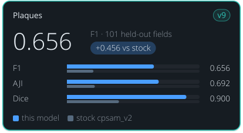

<!-- Generated by tools/build_model_cards.py from spacr/model_zoo.py; edit the zoo record, not this file. -->

# Plaques

v9

**0.656** — F1 · 101 held-out fields

+0.456 vs stock cpsam_v2

| Metric | this model | stock cpsam_v2 |
| --- | --- | --- |
| F1 | 0.656 | 0.200 |
| AJI | 0.692 | 0.211 |
| Dice | 0.900 | 0.392 |

## Toxoplasma Plaque V9 (V8 epoch 100, default)

`toxoplasma_plaque_v9` · Cellpose-SAM (vanilla cpsam_v2 initialization; Cellpose 4.2.1.1) · default in the `toxoplasma_plaque` family

Toxoplasma plaques in crystal-violet plaque-assay wells. Stock Cellpose-SAM was never trained on plaques and finds few of them, fewest on Gel Doc scans.

Other versions: [toxoplasma_plaque_v8](toxoplasma_plaque_v8.md), [toxoplasma_plaque_v6](toxoplasma_plaque_v6.md), [toxoplasma_plaque_v5](toxoplasma_plaque_v5.md), [toxoplasma_plaque_v4](toxoplasma_plaque_v4.md), [toxoplasma_plaque_v3](toxoplasma_plaque_v3.md) (alternative), [toxoplasma_plaque_v2](toxoplasma_plaque_v2.md), [toxoplasma_plaque_v1](toxoplasma_plaque_v1.md).

## Training data

1013 accepted curated well crops; grouped 810 train / 102 validation / 101 test. Historical images were pooled and repartitioned.

All 51192 overlapping 256 px grid windows per epoch from all 810 training crops at a 1500 px longest well side; whole-image D4; 100 epochs from cpsam_v2.

## Hold-out performance

F1 0.656 against stock cpsam_v2's 0.200 on the 101 strict hold-out fields at IoU 0.5; AJI 0.692 against 0.211.

Scorecard state: **reviewed hold-out scorecard**.

| Metric | This model | Stock | Difference |
| --- | --- | --- | --- |
| F1 | 0.6557 | 0.1999 | 0.4558 |
| Boundary F1 (2 px) | 0.7176 | 0.2247 | 0.4929 |
| Precision | 0.7059 | 0.1998 | 0.5061 |
| Recall | 0.6122 | 0.2001 | 0.4121 |
| AJI | 0.6921 | 0.2105 | 0.4816 |
| Dice | 0.9003 | 0.3923 | 0.5080 |

Evaluation set `version8_pooled_curated_grouped_test`, version `strict hold-out, pooled`; 101 scored fields and 4533 annotated objects.

| Recorded | Value |
| --- | --- |
| Training set | 810 training crops; 102 validation crops |
| Training objects | 36411 |
| Test set | 101 fields |
| Test objects | 4533 |
| Cross-validation | no |
| Best epoch | 100 (final epoch; ended on the plateau rule) |

## Notes

- The default plaque model since 2026-11-10, by the maintainer's choice; it replaced toxoplasma_plaque_v6, which stays selectable. It turns well resize on (plaque_well_resize auto follows this record's preprocess).
- Epoch-100 checkpoint of the V8 complete-coverage run, where training ended on its plateau rule; the epoch-50 interim of the same run is toxoplasma_plaque_v8.
- Thresholds chosen on the 102 validation crops (cellprob 0.0, flow 0.4, min size 0); test used for reporting only. The 101 test crops were reported before, for an older V8 attempt and for the epoch-50 interim, so they are not a fresh external or prospective test.
- FP32 inference, 1st/99th percentile normalization; well resized to a 1500 px longest side with no enlargement cap.

## How to read these scores

- **Precision** is the share of objects the model reported that match a reference object; low precision means false detections. **Recall** is the share of reference objects the model found; low recall means missed objects.
- **F1** is the harmonic mean of precision and recall, so it is high only when both are. Either alone can look near-perfect: a model that reports one obvious object has high precision, and one that reports every dark blob has high recall.
- **IoU** (intersection over union) is the overlap between a predicted and a reference object divided by the area the two cover together. A score given at IoU 0.5 counts an object as found when that ratio reaches 0.5.
- **AJI** (aggregated Jaccard index) adds up the overlap of every matched pair and divides it by their combined area plus the area of unmatched objects, so merged, split and missed objects all lower it.
- **Dice** is twice the overlap divided by the predicted area plus the reference area.
- **Stock** is the base model named under Architecture, run without fine-tuning on the same images. **Difference** is this model's score minus stock's.
- A **hold-out** or **test** set is images kept out of training and used only for scoring.

## Files

- Hugging Face: [einarolafsson/toxoplasma-plaque-segmentation-cpsam-v9](https://huggingface.co/einarolafsson/toxoplasma-plaque-segmentation-cpsam-v9)
- File name in spaCR: `cpsam_plaque_v9`
- SHA-256: `8f58d3744fd7b3bcf0fc7cf9f9ecc44030da03b911163f70af689ca9804b8f35`
- Trained by: einarolafsson

Models are hosted on each author's own Hugging Face account. spaCR downloads this one from there the first time it is needed and checks it against the SHA-256 above. `spacr.model_zoo.publish_model` uploads a model and returns the catalogue row to add.

[All model cards](README.md) · [All scorecards as CSV](scorecards.csv)
