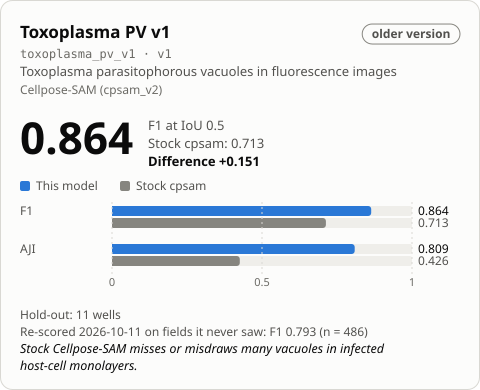

<!-- Generated by tools/build_model_cards.py from spacr/model_zoo.py; edit the zoo record, not this file. -->

# Parasite vacuoles

v1 · older

**0.793** — F1 · 486 held-out fields

+0.391 vs stock cpsam_v2

| Metric | this model | stock cpsam_v2 |
| --- | --- | --- |
| F1 | 0.793 | 0.402 |
| AJI | 0.558 | 0.052 |
| Dice | 0.794 | 0.115 |

## Toxoplasma PV v1

`toxoplasma_pv_v1` · Cellpose-SAM (cpsam_v2) · older version in the `toxoplasma_pv` family

Toxoplasma parasitophorous vacuoles in fluorescence images. Stock Cellpose-SAM misses or misdraws many vacuoles in infected host-cell monolayers.

The family's default is [toxoplasma_pv_v4](toxoplasma_pv_v4.md).

Other versions: [toxoplasma_pv_v5](toxoplasma_pv_v5.md) (alternative), [toxoplasma_pv_v4](toxoplasma_pv_v4.md), [toxoplasma_pv_v3](toxoplasma_pv_v3.md), [toxoplasma_pv_v2](toxoplasma_pv_v2.md).

## Training data

anti-Toxoplasma-biotin and DsRed PV lumen; 229 images from 2 datasets, 104 round-1 and 125 newly curated.

Toxoplasma tachyzoite parasitophorous vacuoles stained with goat anti-Toxoplasma-biotin, and tachyzoites expressing DsRed in the PV lumen. Round 2: 229 training images (round 1's 104 plus 125 newly curated RH and ME49 fields), 100 epochs, base cpsam_v2.

## Hold-out performance

F1 0.793 against stock cpsam_v2's 0.402 on the 486 strict hold-out fields at IoU 0.5; AJI 0.558 against 0.052.

| Metric | This model | Stock | Difference |
| --- | --- | --- | --- |
| F1 | 0.7930 | 0.4016 | 0.3914 |
| Boundary F1 (2 px) | 0.8271 | 0.2584 | 0.5687 |
| Precision | 0.8604 | 0.2921 | 0.5683 |
| Recall | 0.7354 | 0.6427 | 0.0927 |
| AJI | 0.5579 | 0.0517 | 0.5062 |
| Dice | 0.7941 | 0.1149 | 0.6792 |

Evaluation set `gt_rescore_20261011`, version `strict hold-out, pooled`; 486 scored fields and 14315 annotated objects.

| Recorded | Value |
| --- | --- |
| Training set | 229 |
| Test set | 486 fields |
| Test objects | 14315 |
| Cross-validation | no |
| Best epoch | 100 / 100 |

## Notes

- F1 0.864 at IoU 0.5 against 0.713 for stock cpsam on the 11 wells round 1 also held out (round 1 scored 0.867); AJI 0.809 against 0.426.
- Accuracy falls sharply above IoU 0.8 -- suited to counting and area rather than precise morphometry.
- The held-out literature scorecard is pending a stock-seeded re-curation; on the current literature set, whose truth leans toward this model's lineage, it ties stock Cellpose-SAM on detection (F1 0.403 against 0.400).
- Re-scored 2026-10-11 on curated ground truth (spaCR pipeline call, defaults; receipt features/data/model_rescore_curated_gt_2026-10-11/receipt.json): strict hold-out, fields this model never saw, F1 0.793 at IoU 0.5 on n = 486 of 655 fields (n differs between models); common subset unseen by every pv model, n = 163, F1 0.783 (95% bootstrap CI 0.710 to 0.830). Without the 98 paged round-3 fields (n = 65): F1 0.732. Earlier numbers in this row are superseded by this re-score where they differ. Default unchanged.

## How to read these scores

- **Precision** is the share of objects the model reported that match a reference object; low precision means false detections. **Recall** is the share of reference objects the model found; low recall means missed objects.
- **F1** is the harmonic mean of precision and recall, so it is high only when both are. Either alone can look near-perfect: a model that reports one obvious object has high precision, and one that reports every dark blob has high recall.
- **IoU** (intersection over union) is the overlap between a predicted and a reference object divided by the area the two cover together. A score given at IoU 0.5 counts an object as found when that ratio reaches 0.5.
- **AJI** (aggregated Jaccard index) adds up the overlap of every matched pair and divides it by their combined area plus the area of unmatched objects, so merged, split and missed objects all lower it.
- **Dice** is twice the overlap divided by the predicted area plus the reference area.
- **Stock** is the base model named under Architecture, run without fine-tuning on the same images. **Difference** is this model's score minus stock's.
- A **hold-out** or **test** set is images kept out of training and used only for scoring. The re-score note says how many of its fields this model had not seen.

## Files

- Hugging Face: [einarolafsson/toxoplasma-pv-segmentation-cpsam](https://huggingface.co/einarolafsson/toxoplasma-pv-segmentation-cpsam)
- File name in spaCR: `cpsam_v2_toxo_r2`
- SHA-256: `182d8cf6b32c7b9ef2917c85870d188486e5e119f05e9c5c1f07652f6859f2d0`
- Trained by: einarolafsson

Models are hosted on each author's own Hugging Face account. spaCR downloads this one from there the first time it is needed and checks it against the SHA-256 above. `spacr.model_zoo.publish_model` uploads a model and returns the catalogue row to add.

[All model cards](README.md)
