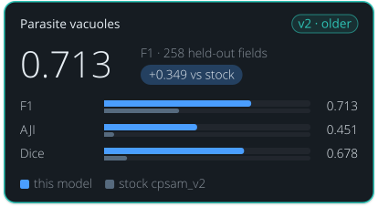

<!-- Generated by tools/build_model_cards.py from spacr/model_zoo.py; edit the zoo record, not this file. -->

# Parasite vacuoles

v2 · older

**0.713** — F1 · 258 held-out fields

+0.349 vs stock cpsam_v2

| Metric | this model | stock cpsam_v2 |
| --- | --- | --- |
| F1 | 0.713 | 0.364 |
| AJI | 0.451 | 0.049 |
| Dice | 0.678 | 0.112 |

## Toxoplasma PV v2 (round 5)

`toxoplasma_pv_v2` · Cellpose-SAM (cpsam_v2) · older version in the `toxoplasma_pv` family

Toxoplasma parasitophorous vacuoles in fluorescence images. Stock Cellpose-SAM misses or misdraws many vacuoles in infected host-cell monolayers.

The family's default is [toxoplasma_pv_v4](toxoplasma_pv_v4.md).

Other versions: [toxoplasma_pv_v5](toxoplasma_pv_v5.md) (alternative), [toxoplasma_pv_v4](toxoplasma_pv_v4.md), [toxoplasma_pv_v3](toxoplasma_pv_v3.md), [toxoplasma_pv_v1](toxoplasma_pv_v1.md).

## Training data

anti-Toxoplasma-biotin and DsRed PV lumen; 556 curated images accumulated over five rounds.

Toxoplasma tachyzoite parasitophorous vacuoles stained with goat anti-Toxoplasma-biotin, and tachyzoites expressing DsRed in the PV lumen (RH and ME49). Round 5: 556 images, 100 epochs, base cpsam_v2.

## Hold-out performance

F1 0.713 against stock cpsam_v2's 0.364 on the 258 strict hold-out fields at IoU 0.5; AJI 0.451 against 0.049.

| Metric | This model | Stock | Difference |
| --- | --- | --- | --- |
| F1 | 0.7130 | 0.3638 | 0.3492 |
| Precision | 0.7658 | 0.2560 | 0.5098 |
| Recall | 0.6670 | 0.6287 | 0.0383 |
| AJI | 0.4507 | 0.0488 | 0.4019 |
| Dice | 0.6782 | 0.1116 | 0.5666 |

Evaluation set `gt_rescore_20261011`, version `strict hold-out, pooled`; 258 scored fields and 5766 annotated objects.

| Recorded | Value |
| --- | --- |
| Training set | 556 |
| Test set | 258 fields |
| Test objects | 5,766 |
| Cross-validation | 5-fold |
| Training loss | 0.0476 |
| Best epoch | 100 / 100 |

## Notes

- Supersedes toxoplasma_pv_v1 (round 2, 229 images): more than twice the training data and cross-validated rather than single-split.
- 5-fold CV over 619 pairs: F1 0.817 (SD 0.036), AJI 0.714, Dice 0.802.
- per-dataset variance is real -- F1 ranges ~0.74 to ~0.93 by screen.
- Accuracy falls above IoU 0.8 -- suited to counting and area rather than precise morphometry.
- Re-scored 2026-10-11 on curated ground truth (spaCR pipeline call, defaults; receipt features/data/model_rescore_curated_gt_2026-10-11/receipt.json): strict hold-out, fields this model never saw, F1 0.713 at IoU 0.5 on n = 258 of 655 fields (n differs between models); common subset unseen by every pv model, n = 163, F1 0.761 (95% bootstrap CI 0.691 to 0.806). Without the 98 paged round-3 fields (n = 65): F1 0.742. Earlier numbers in this row are superseded by this re-score where they differ. Default unchanged.

## How to read these scores

- **Precision** is the share of objects the model reported that match a reference object; low precision means false detections. **Recall** is the share of reference objects the model found; low recall means missed objects.
- **F1** is the harmonic mean of precision and recall, so it is high only when both are. Either alone can look near-perfect: a model that reports one obvious object has high precision, and one that reports every dark blob has high recall.
- **IoU** (intersection over union) is the overlap between a predicted and a reference object divided by the area the two cover together. A score given at IoU 0.5 counts an object as found when that ratio reaches 0.5.
- **AJI** (aggregated Jaccard index) adds up the overlap of every matched pair and divides it by their combined area plus the area of unmatched objects, so merged, split and missed objects all lower it.
- **Dice** is twice the overlap divided by the predicted area plus the reference area.
- **Stock** is the base model named under Architecture, run without fine-tuning on the same images. **Difference** is this model's score minus stock's.
- **Cross-validated** scores split the data into folds, hold out each fold once and report the mean over folds with its standard deviation (**SD**, or +/-). A single split can mislead; the SD shows how far the score moves from one split to another.
- A **hold-out** or **test** set is images kept out of training and used only for scoring. The re-score note says how many of its fields this model had not seen.

## Files

- Hugging Face: [einarolafsson/toxoplasma-pv-segmentation-cpsam-r5](https://huggingface.co/einarolafsson/toxoplasma-pv-segmentation-cpsam-r5)
- File name in spaCR: `cpsam_v2_toxo_r5`
- SHA-256: `17c689e3b117745561e20a885c2a2a998ed360fa97cac8c0446316ae5905c10f`
- Trained by: einarolafsson

Models are hosted on each author's own Hugging Face account. spaCR downloads this one from there the first time it is needed and checks it against the SHA-256 above. `spacr.model_zoo.publish_model` uploads a model and returns the catalogue row to add.

[All model cards](README.md)
