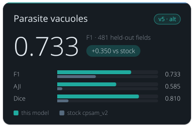

<!-- Generated by tools/build_model_cards.py from spacr/model_zoo.py; edit the zoo record, not this file. -->

# Toxoplasma PV v5 (round 8, alternative)

`toxoplasma_pv_v5` · Cellpose-SAM (cpsam_v2, Cellpose 4.0.9) · alternative in the `toxoplasma_pv` family

Toxoplasma parasitophorous vacuoles in fluorescence images. Stock Cellpose-SAM misses or misdraws many vacuoles in infected host-cell monolayers.

The family's default is [toxoplasma_pv_v4](toxoplasma_pv_v4.md).

Other versions: [toxoplasma_pv_v4](toxoplasma_pv_v4.md), [toxoplasma_pv_v3](toxoplasma_pv_v3.md), [toxoplasma_pv_v2](toxoplasma_pv_v2.md), [toxoplasma_pv_v1](toxoplasma_pv_v1.md).

## Training data

285 curated PV fields (lab fields and published-figure crops), 13,814 vacuoles; 202 train / 33 validation / 50 test grouped by acquisition and paper.

Toxoplasma parasitophorous vacuoles from lab immunofluorescence and DsRed fields and published-figure crops. Round 8, cellpose 4.0.9, best of 100 epochs (epoch 20), base cpsam_v2.

## Hold-out performance

F1 0.733 against stock cpsam_v2's 0.383 on the 481 strict hold-out fields at IoU 0.5; AJI 0.585 against 0.051.

| Metric | This model | Stock | Difference |
| --- | --- | --- | --- |
| F1 | 0.7329 | 0.3831 | 0.3497 |
| Precision | 0.6459 | 0.2749 | 0.3710 |
| Recall | 0.8469 | 0.6322 | 0.2146 |
| AJI | 0.5846 | 0.0509 | 0.5337 |
| Dice | 0.8098 | 0.1119 | 0.6979 |

Evaluation set `gt_rescore_20261011`, version `strict hold-out, pooled`; 481 scored fields and 16213 annotated objects.

| Recorded | Value |
| --- | --- |
| Training set | 202 fields |
| Training objects | 9,276 |
| Test set | 481 fields |
| Test objects | 16,213 |
| Cross-validation | no (grouped train/validation/test) |
| Training loss | see training/epoch_history.json |
| Validation loss | see training/epoch_history.json |
| Best epoch | 20 / 100 |

## Notes

- ALTERNATIVE, NOT BETTER: on the 15 test fields round 7 never saw it scores F1 0.536 against toxoplasma_pv_v4's 0.525 -- a tie; prefer toxoplasma_pv_v4.
- 35 of the 50 test fields were in round 7's training or validation set, so the all-field comparison (0.792 against 0.851) favours toxoplasma_pv_v4 and is not a fair test.
- Weak on published-figure crops (F1 0.440 on 14 literature fields), as is every PV model.
- Re-scored 2026-10-11 on curated ground truth (spaCR pipeline call, defaults; receipt features/data/model_rescore_curated_gt_2026-10-11/receipt.json): strict hold-out, fields this model never saw, F1 0.733 at IoU 0.5 on n = 481 of 655 fields (n differs between models); common subset unseen by every pv model, n = 163, F1 0.633 (95% bootstrap CI 0.544 to 0.695). Without the 98 paged round-3 fields (n = 65): F1 0.665. Earlier numbers in this row are superseded by this re-score where they differ. LEAKED: this model trained or validated on 29 of 39 curated PV literature hold-out fields and 3 of 11 anchor wells, so its earlier hold-out scores are not hold-out scores; the re-score uses only the fields it never saw. Default unchanged.

## How to read these scores

- **Precision** is the share of objects the model reported that match a reference object; low precision means false detections. **Recall** is the share of reference objects the model found; low recall means missed objects.
- **F1** is the harmonic mean of precision and recall, so it is high only when both are. Either alone can look near-perfect: a model that reports one obvious object has high precision, and one that reports every dark blob has high recall.
- **IoU** (intersection over union) is the overlap between a predicted and a reference object divided by the area the two cover together. A score given at IoU 0.5 counts an object as found when that ratio reaches 0.5.
- **AJI** (aggregated Jaccard index) adds up the overlap of every matched pair and divides it by their combined area plus the area of unmatched objects, so merged, split and missed objects all lower it.
- **Dice** is twice the overlap divided by the predicted area plus the reference area.
- **Stock** is the base model named under Architecture, run without fine-tuning on the same images. **Difference** is this model's score minus stock's.
- A **hold-out** or **test** set is images kept out of training and used only for scoring. The re-score note says how many of its fields this model had not seen.

## Files

- Hugging Face: [einarolafsson/toxoplasma-pv-segmentation-cpsam-r8](https://huggingface.co/einarolafsson/toxoplasma-pv-segmentation-cpsam-r8)
- File name in spaCR: `cpsam_v2_toxo_r8`
- SHA-256: `a1d7f1a978cf4925ec60db486a00eea33e87e6fc5a6b0d0f34c6db5f132d5c1c`
- Trained by: einarolafsson

Models are hosted on each author's own Hugging Face account. spaCR downloads this one from there the first time it is needed and checks it against the SHA-256 above. `spacr.model_zoo.publish_model` uploads a model and returns the catalogue row to add.

[All model cards](README.md)
