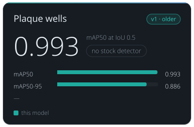

<!-- Generated by tools/build_model_cards.py from spacr/model_zoo.py; edit the zoo record, not this file. -->

# Plaque wells

v1 · older

**0.993** — mAP50 at IoU 0.5

no stock detector

| Metric | this model |
| --- | --- |
| mAP50 | 0.993 |
| mAP50-95 | 0.886 |
|  | — |

## Toxoplasma Plaque Well Detector v1

`toxoplasma_well_detector_v1` · YOLO11n · older version in the `toxoplasma_well_detector` family

Plaque-assay wells in plate photos and published figures (boxes). No stock detector has a plaque-well class; the well found first makes plaque sizes comparable across scanners.

The family's default is [toxoplasma_well_detector_v3](toxoplasma_well_detector_v3.md).

Other versions: [toxoplasma_well_detector_v3](toxoplasma_well_detector_v3.md), [toxoplasma_well_detector_v2](toxoplasma_well_detector_v2.md).

## Training data

whole-plate and multi-well crystal violet images; 562 images from 1 dataset, 190 of them with no well in them.

whole-plate and multi-well Toxoplasma plaque-assay images; yolo11n base, 150 epochs, batch 16, imgsz 640.

## Hold-out performance

mAP50 0.993 on its own held-out split; on the test set shared with v2 it scores mAP50 0.8838, against v2's 0.9457.

Scorecard state: **recorded at publication**. These numbers were recorded with the model when it was published; a reviewed held-out comparison against the stock model is not yet available.

| Recorded | Value |
| --- | --- |
| Training set | 562 images |
| Test set | held-out split |
| Cross-validation | no |
| Scores | mAP50 0.9930 on v3's own split; 0.8838 on the shared test set; mAP50-95 0.8860 own split; 0.7630 shared; P/R 0.9870 own split; P 0.8613 / R 0.9085 shared |
| Best epoch | 150 / 150 |

## Notes

- The 0.993 is measured on v3's OWN split, which is easier than the set v2 is measured on; on that shared set this model scores mAP50 0.8838 against v2's 0.9457, so v2 is the better detector.
- Kept because the published plaque corpus was measured with these weights, so results in the paper trace back to this row.
- Locates WELLS, not plaques; it is the front half of a two-stage pipeline with toxoplasma_plaque_v1, and the well it finds also gives the diameter that makes areas comparable across microscopes.

## How to read these scores

- **mAP50** is the mean average precision of the predicted boxes when a box counts as correct at an IoU of 0.5 or more with a reference box. **mAP50-95** averages it over ten IoU thresholds from 0.5 to 0.95, so loosely placed boxes score lower.
- **IoU** (intersection over union) is the overlap between a predicted and a reference box divided by the area the two cover together.
- **Precision** (P) is the share of predicted boxes that match a reference box; low precision means false boxes. **Recall** (R) is the share of reference boxes the model found; low recall means missed wells.
- There is no stock model with a plaque-well class, so a detector is compared with an earlier spaCR detector scored on the same test images.
- A **hold-out** or **test** set is images kept out of training and used only for scoring.

## Files

- Hugging Face: [einarolafsson/toxoplasma-plaque-well-detector-yolo11](https://huggingface.co/einarolafsson/toxoplasma-plaque-well-detector-yolo11)
- File name in spaCR: `yolo_welldetect_v3.pt`
- SHA-256: `b826058754fb5d4df36c3a7283aac049015cbb044b5ef096c55d19f37172a50c`
- Trained by: einarolafsson

Models are hosted on each author's own Hugging Face account. spaCR downloads this one from there the first time it is needed and checks it against the SHA-256 above. `spacr.model_zoo.publish_model` uploads a model and returns the catalogue row to add.

[All model cards](README.md) · [All scorecards as CSV](scorecards.csv)
