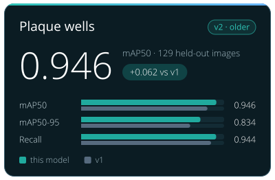

<!-- Generated by tools/build_model_cards.py from spacr/model_zoo.py; edit the zoo record, not this file. -->

# Toxoplasma Plaque Well Detector v2

`toxoplasma_well_detector_v2` · YOLO26n (ultralytics 8.4.155) · older version in the `toxoplasma_well_detector` family

The family's default is [toxoplasma_well_detector_v3](toxoplasma_well_detector_v3.md).

Other versions: [toxoplasma_well_detector_v3](toxoplasma_well_detector_v3.md), [toxoplasma_well_detector_v1](toxoplasma_well_detector_v1.md).

## Training data

Plate images and literature figures; 1,070 train / 254 val / 129 test, split by PMC article so no paper is in two sets; training data at einarolafsson/toxoplasma-plaque-well-detector-dataset.

whole-plate and multi-well Toxoplasma plaque-assay images plus 939 newly reviewed PMC figures, accepted boxes and confirmed negatives alike; yolo26n base, best validation mAP50-95 at epoch 28.

## Hold-out performance

mAP50 0.9457 and mAP50-95 0.8341 against v1's (yolo_welldetect_v3.pt) 0.8838 and 0.7630 on the SAME test set; stock YOLO has no plaque-well class, so v1 is the baseline.

| Recorded | Value |
| --- | --- |
| Training set | 1,070 images |
| Training objects | 2,455 boxes |
| Test set | 129 images, 84 of them with no well |
| Test objects | 297 boxes |
| Cross-validation | no |
| Scores | mAP50 0.9457 (shared test set); mAP50-95 0.8341; P 0.8912 / R 0.9440 |
| Baseline | v1 scores 0.8838 on this set; v1 scores 0.7630; v1 P 0.8613 / R 0.9085 |
| Best epoch | 28 |

## Notes

- On the shared test set it beats v1 (the v3 weights) on every measure, and cuts false boxes on no-well figures from 152 to 49.
- 84 of the 129 test images contain no well at all, which is what the false-box count is measured on.
- Locates WELLS, not plaques; the front half of a two-stage pipeline with the plaque segmentation model.
- The repository publishes this weight as weights/best.pt; spaCR saves it under the name above so two detectors cannot both land as best.pt.

## How to read these scores

- **mAP50** is the mean average precision of the predicted boxes when a box counts as correct at an IoU of 0.5 or more with a reference box. **mAP50-95** averages it over ten IoU thresholds from 0.5 to 0.95, so loosely placed boxes score lower.
- **IoU** (intersection over union) is the overlap between a predicted and a reference box divided by the area the two cover together.
- **Precision** (P) is the share of predicted boxes that match a reference box; low precision means false boxes. **Recall** (R) is the share of reference boxes the model found; low recall means missed wells.
- There is no stock model with a plaque-well class, so a detector is compared with an earlier spaCR detector scored on the same test images.
- A **hold-out** or **test** set is images kept out of training and used only for scoring.

## Files

- Hugging Face: [einarolafsson/toxoplasma-plaque-well-detector-yolo26](https://huggingface.co/einarolafsson/toxoplasma-plaque-well-detector-yolo26)
- File name in spaCR: `yolo_welldetect_v4.pt`
- SHA-256: `f2a1e1110f09b2a1d5ef5545adaba7c57f1158669d0bfc50d8fabe9f86da30c7`
- Trained by: einarolafsson

Models are hosted on each author's own Hugging Face account. spaCR downloads this one from there the first time it is needed and checks it against the SHA-256 above. `spacr.model_zoo.publish_model` uploads a model and returns the catalogue row to add.

[All model cards](README.md)
